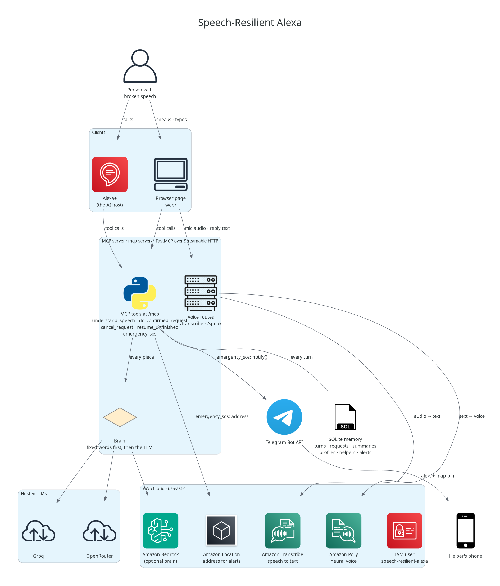
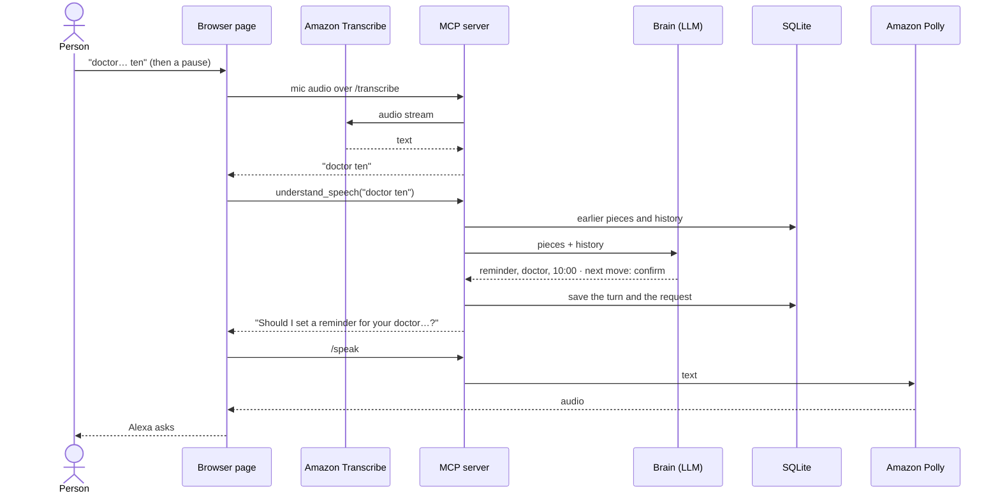

# Speech-Resilient Alexa

An Alexa+ add-on for people whose speech is slow, comes out in pieces, or needs correcting. It keeps every piece heard, guesses the request, asks only for what's missing, and never acts without a yes.

## For judges

- Track: **Alexa+**, as a self-hosted **MCP server**.
- Transport: **Streamable HTTP** at `http://127.0.0.1:8000/mcp`.
- MCP spec: negotiates **2025-11-25 or later** (the test suite checks this).
- Where MCP is imported and called: `mcp-server/server.py`.
- Every tool call carries the person's sign-in token (bearer). The server takes the person from the token, never from tool input, so nobody can reach another person's memory or helpers.
- Uses the real OpenRouter brain by default. Add `OPENROUTER_API_KEY` to `.env` before starting it.

## Architecture



A version with the Groq and OpenRouter logos is in [docs/architecture-logos.png](docs/architecture-logos.png). Both pictures are drawn from [docs/architecture.py](docs/architecture.py) with the official AWS icons; after a change, run it again (it needs Graphviz: `sudo apt install graphviz`):

```bash
uv run --no-project --with diagrams python docs/architecture.py
```

One turn, end to end, in the browser page:



What each part does:

| Part | What it does |
| ---- | ------------ |
| **Browser page** (`web/`) | Plays Alexa's part for the demo. It sends each spoken or typed piece to `understand_speech`, makes the follow-up call (`do_confirmed_request`, `cancel_request`, `ask_for_help`, `emergency_sos`), and speaks the reply. If Transcribe or Polly can't be reached, it falls back to the browser's own speech recognition and voice. |
| **Alexa+** | The real host. It calls the same MCP tools, so nothing changes on the server. |
| **MCP tools** (`tools/`) | One file per tool. Each turn's words go to `understand_speech`, which keeps the pieces and decides the next move. |
| **Fixed words** (`messages/vocabulary.py`) | Yes, no, SOS and stop are checked without the brain, so they work even when the LLM is down. |
| **Brain** (`brain/`) | An LLM that guesses the request from the pieces and the history. OpenRouter, Groq or Bedrock, picked by `LLM_PROVIDER`; the mock brain replays recorded answers in tests. |
| **Memory** (`memory/`, SQLite) | Every turn, the request in progress, a summary of older chat, what Alexa did, and the people who get emergency alerts. Details in [docs/memory.md](docs/memory.md). |
| **Amazon Transcribe** | Turns the microphone into text, behind the server's `/transcribe` WebSocket, so AWS keys never reach the browser. |
| **Amazon Polly** | Alexa's voice, behind the server's `/speak` route. |
| **Amazon Location** | Turns an emergency alert's coordinates into an address (`ReverseGeocode`). |
| **Telegram** | Delivers emergency alerts to helpers, with a map pin. Helpers link themselves by opening the bot from the page. |

## AWS services

Three AWS services run in the product, each behind the MCP server so AWS keys never reach the browser. They use the AWS credentials and `AWS_REGION` (default `us-east-1`), and the IAM user `speech-resilient-alexa` gets only what they need.

| Service | What it does here | Where in the code | IAM permission |
| ------- | ----------------- | ----------------- | -------------- |
| **Amazon Transcribe** (streaming) | Turns the microphone into text while the person talks. The page streams 16 kHz audio to the server's `/transcribe` WebSocket, the server relays it to Transcribe and sends each finished piece back, one turn per pause. | `mcp-server/transcription/stream.py`, `web/src/transcribe.js` | `AmazonTranscribeFullAccess` |
| **Amazon Polly** (neural voice) | Alexa's voice. Every reply goes to the server's `/speak` route and comes back as MP3. | `mcp-server/speech/polly.py`, `web/src/polly.js` | `AmazonPollyFullAccess` |
| **Amazon Location Service** (`ReverseGeocode`) | Turns the coordinates of an emergency alert into a street address, so a helper reads "Where: 2 Mohamed Fahmy El Mahdar Street, Cairo" next to the map link. One try, 2 second timeout; if it fails, the alert still goes. | `mcp-server/location/geocoder.py`, used by `mcp-server/tools/emergency_sos.py` | inline policy: `geo-places:ReverseGeocode` |
| **EventBridge Scheduler + SNS** | Sends a real email reminder at the requested time. Each account gets a separate SNS topic; the person must confirm their email subscription before reminders can be scheduled. | `mcp-server/reminders/`, `mcp-server/tools/do_confirmed_request.py` | `sns:CreateTopic`, `sns:Subscribe`, `sns:ListSubscriptionsByTopic`, `scheduler:CreateSchedule`, and `iam:PassRole`; scheduler role needs `sns:Publish` on the reminder topics |

Together they form one pipeline: speech in through **Transcribe**, understood by the MCP tools, the answer out through **Polly**, and in an emergency the place through **Location**.

**Amazon Bedrock** is wired in as a brain (`LLM_PROVIDER=bedrock`, Nova Lite through the Converse API, `mcp-server/brain/llm/bedrock.py`), but our account can't call any model yet, so the demo uses Groq.

### Real email reminders

The reminder address is saved to the signed-in person's profile. Saving it creates a private SNS topic and sends the SNS confirmation email. The person must confirm that email before a reminder can be scheduled. After they say “yes”, EventBridge Scheduler publishes the reminder to that person's topic at the exact date and time returned by the model. The app uses `REMINDER_TIMEZONE` (default `Africa/Cairo`).

Set up an EventBridge Scheduler execution role with `sns:Publish` limited to topics named `speech-alexa-reminder-*`, then set its ARN in `REMINDER_SCHEDULER_ROLE_ARN`. The credentials used by the MCP server also need to create and subscribe to those SNS topics, create schedules in the `default` schedule group, and pass only that execution role. See [the AWS reminder setup guide](docs/aws-reminders.md) for the steps. Calls and text messages remain simulated actions.

## Run it

```bash
uv sync
cp .env.example .env
uv run python mcp-server/server.py
```

Then open MCP Inspector in another terminal and connect with **Streamable HTTP** to the URL above:

```bash
npx -y @modelcontextprotocol/inspector
```

## Try the demo in MCP Inspector

The tools need a signed-in person. Create one and copy the `token` from the answer:

```bash
curl -s -X POST http://127.0.0.1:8000/signup -H 'Content-Type: application/json' \
  -d '{"username":"demo","name":"Demo","password":"secret1"}'
```

In MCP Inspector, open **Authentication**, choose **Bearer Token** and paste it. Then call `understand_speech` three times:

| Turn | `heard`      | What comes back                                                   |
| ---- | ------------ | ----------------------------------------------------------------- |
| 1    | `tomorrow`   | `next_move: listen`, "Mm-hm, go on."                              |
| 2    | `doctor ten` | `next_move: confirm`, "Should I set a reminder for your doctor…?" |
| 3    | `yes`        | `next_move: done`, plus a `pending_id`                            |

Then call `do_confirmed_request` with that `pending_id`. You get "Done. Reminder set: doctor appointment, tomorrow 10:00."

Stop the server between turn 1 and turn 2, start it again, and the pieces are still there.

## Try it in the browser

`web/` is a small page that talks to `/mcp` directly from the browser, with no backend in between. Keep the server running and, in another terminal:

```bash
cd web
npm install
npm run dev
```

Open the URL Vite prints (`http://localhost:5180` by default; set `WEB_PORT` in `web/.env` to change it) create an account (a username, the name Alexa calls you by, and a password), and send `tomorrow`, `doctor ten`, `yes`. The browser stays signed in until you sign out, so the family can sign in once for the person. The page sends the sign-in token with every tool call, and the server knows the person from it; a real Alexa+ host would pass the token it holds for the Amazon account instead. Details: [feature-sign-in.md](docs/branches/feature-sign-in.md). The page has no AI of its own, so it makes the follow-up call Alexa would make: `do_confirmed_request` after a `done`, `cancel_request` after a `cancel`.

To talk instead of type, press **Speak**. Alexa learns how long each person pauses in the middle of a sentence and waits that long before she answers, instead of jumping in at every pause; the pieces said meanwhile go to the server together, with the pauses measured between them. Details: [feature-learn-pauses.md](docs/branches/feature-learn-pauses.md).

The microphone streams to the server's `/transcribe` WebSocket, which passes it to **Amazon Transcribe** and sends the text back; the AWS credentials never reach the browser, and the MCP tools still only receive text. This needs AWS credentials with Transcribe access (`AmazonTranscribeFullAccess`). If Transcribe can't be reached, the page falls back to the browser's own speech recognition (Chrome or Edge).

Alexa reads every reply aloud. The text goes to the server's `/speak` route, which returns **Amazon Polly** audio (`POLLY_VOICE_ID`, `POLLY_ENGINE`); without AWS credentials the page uses the browser's own voice instead, so there is nothing to set up. The microphone pauses while she talks and comes back when she finishes. **Mute Alexa** turns the voice off; pressing it mid-reply cuts her off at once.

Say "I fell", "help help" or "emergency" and a red countdown starts. Say "stop" to cancel it; stay silent and the alert goes to the person's helpers on Telegram, with the address from **Amazon Location** and a map pin. To set it up, open **People who help me** at the bottom of the page: add a helper, and have the helper open their link and press Start. The alert carries the name on the person's account. This needs `TELEGRAM_BOT_TOKEN` (a bot from Telegram's BotFather) and AWS credentials with `geo-places:ReverseGeocode`; without the token, alerts are written to the server log. Details: [feature-emergency-sos.md](docs/branches/feature-emergency-sos.md).

The server accepts browser calls from any `localhost` port. To allow another page, add its URL to `MCP_CORS_ORIGINS`.

## Tools

| Tool                   | What it does                                                                                           |
| ---------------------- | ------------------------------------------------------------------------------------------------------ |
| `understand_speech`    | Takes the exact words of one turn, adds them to earlier pieces, returns what was understood and the next move. |
| `do_confirmed_request` | Carries out a request. Refuses unless the person clearly said yes.                                     |
| `cancel_request`       | Drops the request in progress.                                                                         |
| `resume_unfinished`    | At the start of a session, offers back a request left unfinished last time.                            |
| `emergency_sos`        | Sends the person's helpers an emergency alert with where they are, after a countdown nobody stopped.   |
| `speech_trend`         | How many questions Alexa needed per finished request, day by day, so progress is visible.             |
| `ask_for_help`         | Sends the person's helpers what Alexa understood so far, when they say "help" or she keeps failing.   |

## Settings

Everything is read from environment variables. `.env.example` lists every setting with its default.

| Setting                        | What it controls                                                      |
| ------------------------------ | --------------------------------------------------------------------- |
| `LLM_PROVIDER`                 | `openrouter` (default), `groq` or `bedrock`                           |
| `MCP_CORS_ORIGINS`             | Extra browser pages allowed to call the server (localhost is always allowed) |
| `MEMORY_DB_PATH`               | The SQLite file that holds memory                                     |
| `MEMORY_UNFINISHED_TTL_HOURS`  | How long an unfinished request is offered back                        |
| `MEMORY_RECENT_MESSAGES`       | How many recent messages the brain always sees in full                |
| `MEMORY_SUMMARY_TRIGGER_WORDS` | How long the history can get before older parts are summarized        |
| `SOS_COUNTDOWN_SECONDS`        | How long Alexa waits for "stop" before sending an emergency alert     |
| `SOS_COOLDOWN_MINUTES`         | How soon the same emergency alert can be sent again                   |
| `PAUSE_START_SECONDS`, `PAUSE_MIN_SECONDS`, `PAUSE_MAX_SECONDS` | How long Alexa waits for a new person, and the limits of what she learns |
| `YES_NO_AFTER_TRIES`           | After this many questions about one request, Alexa guesses and asks yes or no instead |
| `TREND_DAYS`                   | How many days `speech_trend` looks back                               |
| `HELP_AFTER_TRIES`             | After this many questions about one request, Alexa sends the helper what she understood so far |
| `TELEGRAM_BOT_TOKEN`           | The bot that delivers emergency alerts; empty writes them to the log  |
| `LOCATION_ENABLED`             | Whether Amazon Location adds an address to emergency alerts           |

To use a real model, set `LLM_PROVIDER=openrouter` and `OPENROUTER_API_KEY`, `LLM_PROVIDER=groq` and `GROQ_API_KEY` (Groq has a free tier), or `LLM_PROVIDER=bedrock` with AWS credentials.

## Tests

```bash
uv run pytest
uv run ruff check mcp-server tests
```

The tests start the real server over Streamable HTTP and talk to it like an agent would. They use a deterministic test-only brain, so they do not spend API credits.

The browser page has its own tests:

```bash
cd web
npm test
```

## Layout

```text
mcp-server/
  server.py     the MCP server: tools, lifespan, MCP is called here
  config/       settings, all from environment variables
  enums/        fixed values: providers, moves, intents, statuses
  messages/     every text in one place: replies, errors, prompts, tool descriptions
  brain/        the LLM brain, the mock brain, the summarizer, one client per provider
  memory/       SQLite store, history and summaries
  actions/      simulated reminder, message and call
  notify/       the one way messages leave the server: Telegram, or the log
  location/     Amazon Location, an address for emergency alerts
  people/       the page's account (sign up, sign in) and setup routes: the profile and the helpers
  pacing/       learns how long each person pauses, so Alexa waits for them
  tools/        one file per MCP tool
  utils/        ids and time
data/           recorded answers for mock mode
web/            browser demo page, a plain MCP client (Vite, no backend)
docs/           design notes
tests/          real tests over HTTP and a real SQLite file
```
