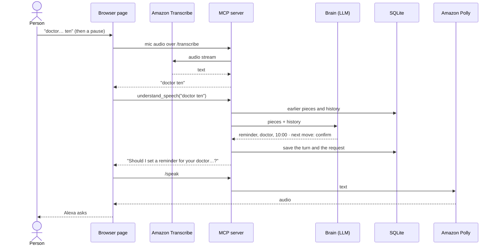

# Speech-Resilient Alexa

An Alexa+ add-on for people whose speech is slow, comes out in pieces, or needs correcting. It keeps every piece heard, guesses the request, asks only for what's missing, and never acts without a yes.

## For judges

- Track: **Alexa+**, as a self-hosted **MCP server**.
- Transport: **Streamable HTTP** at `http://127.0.0.1:8000/mcp`.
- MCP spec: negotiates **2025-11-25 or later** (the test suite checks this).
- Where MCP is imported and called: `mcp-server/server.py`.
- Uses the real OpenRouter brain by default. Add `OPENROUTER_API_KEY` to `.env` before starting it.

## Architecture


Dashed arrows are planned, not built yet. The picture is drawn from [docs/architecture.py](docs/architecture.py) with the official AWS icons; after a change, run it again (it needs Graphviz: `sudo apt install graphviz`):

```bash
uv run --no-project --with diagrams python docs/architecture.py
```

One turn, end to end, in the browser page:



What each part does:

| Part | What it does |
| ---- | ------------ |
| **Browser page** (`web/`) | Plays Alexa's part for the demo. It sends each spoken or typed piece to `understand_speech`, makes the follow-up call (`do_confirmed_request`, `cancel_request`, `emergency_sos`), and speaks the reply. If Transcribe or Polly can't be reached, it falls back to the browser's own speech recognition and voice. |
| **Alexa+** | The real host. It calls the same MCP tools, so nothing changes on the server. |
| **MCP tools** (`tools/`) | One file per tool. Each turn's words go to `understand_speech`, which keeps the pieces and decides the next move. |
| **Fixed words** (`messages/vocabulary.py`) | Yes, no, SOS and stop are checked without the brain, so they work even when the LLM is down. |
| **Brain** (`brain/`) | An LLM that guesses the request from the pieces and the history. OpenRouter, Groq or Bedrock, picked by `LLM_PROVIDER`; the mock brain replays recorded answers in tests. |
| **Memory** (`memory/`, SQLite) | Every turn, the request in progress, a summary of older chat, what Alexa did, and the people who get emergency alerts. Details in [docs/memory.md](docs/memory.md). |
| **Amazon Transcribe** | Turns the microphone into text, behind the server's `/transcribe` WebSocket, so AWS keys never reach the browser. |
| **Amazon Polly** | Alexa's voice, behind the server's `/speak` route. |
| **Amazon Location** | Will turn the alert's coordinates into an address. |
| **Telegram** | Will deliver emergency alerts to helpers, with a map pin. |

## Run it

```bash
uv sync
cp .env.example .env
uv run python mcp-server/server.py
```

Then open MCP Inspector in another terminal and connect with **Streamable HTTP** to the URL above:

```bash
npx -y @modelcontextprotocol/inspector
```

## Try the demo in MCP Inspector

Call `understand_speech` three times for the same `user_id`:

| Turn | `heard`      | What comes back                                                   |
| ---- | ------------ | ----------------------------------------------------------------- |
| 1    | `tomorrow`   | `next_move: listen`, "Mm-hm, go on."                              |
| 2    | `doctor ten` | `next_move: confirm`, "Should I set a reminder for your doctor…?" |
| 3    | `yes`        | `next_move: done`, plus a `pending_id`                            |

Then call `do_confirmed_request` with that `pending_id`. You get "Done. Reminder set: doctor appointment, tomorrow 10:00."

Stop the server between turn 1 and turn 2, start it again, and the pieces are still there.

## Try it in the browser

`web/` is a small page that talks to `/mcp` directly from the browser, with no backend in between. Keep the server running and, in another terminal:

```bash
cd web
npm install
npm run dev
```

Open the URL Vite prints (`http://localhost:5180` by default; set `WEB_PORT` in `web/.env` to change it) and send `tomorrow`, `doctor ten`, `yes`. The page has no AI of its own, so it makes the follow-up call Alexa would make: `do_confirmed_request` after a `done`, `cancel_request` after a `cancel`.

To talk instead of type, press **Speak**. Every pause sends what was said as its own turn, so slow, broken-up speech reaches the server in pieces, the way Alexa would pass it on.

The microphone streams to the server's `/transcribe` WebSocket, which passes it to **Amazon Transcribe** and sends the text back; the AWS credentials never reach the browser, and the MCP tools still only receive text. This needs AWS credentials with Transcribe access (`AmazonTranscribeFullAccess`). If Transcribe can't be reached, the page falls back to the browser's own speech recognition (Chrome or Edge).

Alexa reads every reply aloud. The text goes to the server's `/speak` route, which returns **Amazon Polly** audio (`POLLY_VOICE_ID`, `POLLY_ENGINE`); without AWS credentials the page uses the browser's own voice instead, so there is nothing to set up. The microphone pauses while she talks and comes back when she finishes. **Mute Alexa** turns the voice off; pressing it mid-reply cuts her off at once.

Say "I fell", "help help" or "emergency" and a red countdown starts. Say "stop" to cancel it; stay silent and the alert goes to the person's helpers. Until Telegram is connected, the alert is written to the server log. Details: [feature-emergency-sos.md](docs/branches/feature-emergency-sos.md).

The server accepts browser calls from any `localhost` port. To allow another page, add its URL to `MCP_CORS_ORIGINS`.

## Tools

| Tool                   | What it does                                                                                           |
| ---------------------- | ------------------------------------------------------------------------------------------------------ |
| `understand_speech`    | Takes the exact words of one turn, adds them to earlier pieces, returns what was understood and the next move. |
| `do_confirmed_request` | Carries out a request. Refuses unless the person clearly said yes.                                     |
| `cancel_request`       | Drops the request in progress.                                                                         |
| `resume_unfinished`    | At the start of a session, offers back a request left unfinished last time.                            |
| `emergency_sos`        | Sends the person's helpers an emergency alert with where they are, after a countdown nobody stopped.   |

## Settings

Everything is read from environment variables. `.env.example` lists every setting with its default.

| Setting                        | What it controls                                                      |
| ------------------------------ | --------------------------------------------------------------------- |
| `LLM_PROVIDER`                 | `openrouter` (default), `groq` or `bedrock`                           |
| `MCP_CORS_ORIGINS`             | Extra browser pages allowed to call the server (localhost is always allowed) |
| `MEMORY_DB_PATH`               | The SQLite file that holds memory                                     |
| `MEMORY_UNFINISHED_TTL_HOURS`  | How long an unfinished request is offered back                        |
| `MEMORY_RECENT_MESSAGES`       | How many recent messages the brain always sees in full                |
| `MEMORY_SUMMARY_TRIGGER_WORDS` | How long the history can get before older parts are summarized        |
| `SOS_COUNTDOWN_SECONDS`        | How long Alexa waits for "stop" before sending an emergency alert     |
| `SOS_COOLDOWN_MINUTES`         | How soon the same emergency alert can be sent again                   |

To use a real model, set `LLM_PROVIDER=openrouter` and `OPENROUTER_API_KEY`, `LLM_PROVIDER=groq` and `GROQ_API_KEY` (Groq has a free tier), or `LLM_PROVIDER=bedrock` with AWS credentials.

## Tests

```bash
uv run pytest
uv run ruff check mcp-server tests
```

The tests start the real server over Streamable HTTP and talk to it like an agent would. They use a deterministic test-only brain, so they do not spend API credits.

The browser page has its own tests:

```bash
cd web
npm test
```

## Layout

```text
mcp-server/
  server.py     the MCP server: tools, lifespan, MCP is called here
  config/       settings, all from environment variables
  enums/        fixed values: providers, moves, intents, statuses
  messages/     every text in one place: replies, errors, prompts, tool descriptions
  brain/        the LLM brain, the mock brain, the summarizer, one client per provider
  memory/       SQLite store, history and summaries
  actions/      simulated reminder, message and call
  notify/       the one way messages leave the server (emergency alerts)
  tools/        one file per MCP tool
  utils/        ids and time
data/           recorded answers for mock mode
web/            browser demo page, a plain MCP client (Vite, no backend)
docs/           design notes
tests/          real tests over HTTP and a real SQLite file
```
