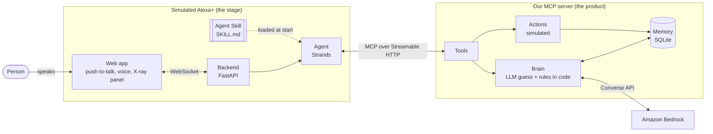
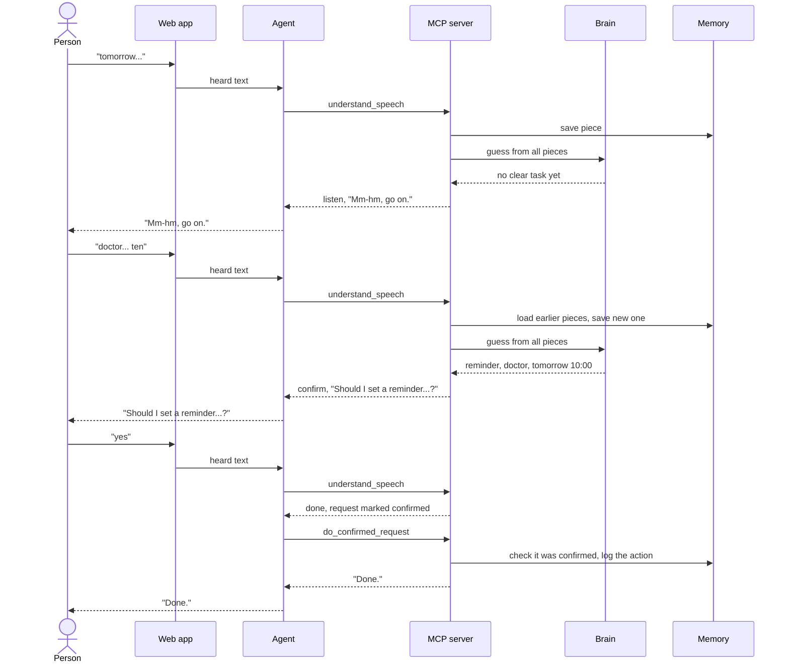

# System Design

Speech-Resilient Alexa is an Alexa+ add-on for people whose speech is slow, comes out in pieces, or needs correcting. Today's assistants fail when a command comes out broken, and the person has to start again. Ours keeps every piece, makes a smart guess, and asks only for what's missing.

This page shows how the parts fit together. Each part has its own page with the details.

## The big picture



## Where each part fits

| Part | Its job | Page |
| --- | --- | --- |
| MCP server | The Alexa+ add-on. Exposes our tools to any Alexa+-style agent. | [mcp-server.md](mcp-server.md) |
| Brain | Turns broken pieces into one clear request and picks the next move. | [brain.md](brain.md) |
| Memory | Keeps every piece, survives closing the app, stays small. | [memory.md](memory.md) |
| Agent Skill | Our behavior rules, written so any agent can load them. | [agent-skill.md](agent-skill.md) |
| Simulated Alexa+ | What judges see and hear: voice, device screen, X-ray panel. | [simulator.md](simulator.md) |
| Testing | Proves it works, with numbers. | [testing.md](testing.md) |

The key idea is **where the intelligence lives**. In real Alexa+, Amazon's AI runs the conversation and add-ons provide tools. So everything that makes speech resilient lives in our MCP server, where any Alexa+-style assistant could use it. The simulator only shows what it feels like.

Inside the server, the split is simple: **the LLM guesses meaning, our code enforces the rules.** The LLM is good at reading "ten tomorrow dentist remind". Code is good at never acting without a yes.

## One turn, step by step

The demo scenario: "tomorrow…", then "doctor… ten", then "yes".



## Folder layout

```text
mcp-server/            the MCP server, brain, memory and actions
skills/                the Agent Skill (SKILL.md and example conversations)
simulator/             backend (FastAPI + Strands agent) and web (React)
eval/                  the test set and scoring script
data/                  the demo profile (name, time zone, contacts)
docs/                  these pages and the friction log
```

The brain never imports simulator code, so it can always be tested on its own.

## Configuration

Every setting lives in an environment variable, and nothing is hardcoded. `.env.example` lists them all. Each page lists the ones that belong to its part.

## What's in and what's out

| In | Out |
| --- | --- |
| Our MCP server as the Alexa+ add-on | A classic Alexa custom skill |
| An Agent Skill with our behavior rules | Training our own speech recognition |
| A simulated Alexa+ with voice and an X-ray panel | Real phone calls or real calendars |
| Reminders, messages and calls (simulated) | Other languages |
| Memory across sessions | Running inside real Alexa+ (partner-only) |
