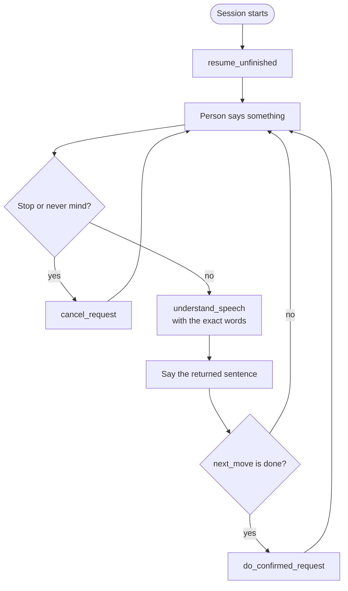

# Agent Skill

An Agent Skill is a folder with a `SKILL.md` file: a name, a description of when to use it, and instructions. It's an open format that many agents can load. Ours turns our behavior rules into something any agent can pick up and follow.

The MCP server gives an agent the tools. The skill tells the agent how to use them.

## Where it lives

```text
skills/speech-resilience/
  SKILL.md                  the rules and when to use them
  references/examples.md    five or six full example conversations
```

The simulator's agent loads it at start.

## The eight rules

These rules are the product. They go into the skill, the prompt, the reply wording and the tests. If a behavior breaks one of them, it's a bug.

1. **Never make them start over.** Keep every piece we heard, even after a pause or a misheard word.
2. **Guess, then confirm.** One yes-or-no question beats three separate questions.
3. **Ask for one missing thing at a time,** in a few words. "What time?", not "Please tell me the date and time of your reminder."
4. **Accept any kind of yes or no.** Yeah, yep, mm-hm, right, that's it, nope, no no.
5. **A correction changes only the corrected part.** "Tuesday… no, Wednesday" changes the day and nothing else.
6. **Give time.** Calm, short cues. Push-to-talk means we never cut anyone off.
7. **Always confirm before acting,** especially for messages and calls. The server enforces this, not just the prompt.
8. **Keep replies short and plain.** Around 15 words or fewer.

## What the agent does on each turn



## What SKILL.md says

- **Front matter:** the name `speech-resilience`, and a description that says exactly when to use it. The description is what an agent sees before deciding to load the skill, so it has to be precise.
- **Instructions:**
  1. Pass the person's exact words to `understand_speech` on every turn of a request.
  2. Say the sentence the tool returns.
  3. Ask one thing at a time.
  4. Never act without a clear yes. Only then call `do_confirmed_request`.
  5. Treat "no", "wait" and "I mean" as corrections, not cancels.
  6. If nothing useful was heard, say "Take your time. I'm still listening."
- **References:** full example conversations in `references/examples.md`.

## Why a skill and not a long system prompt

A system prompt works, but it's stuck inside one app. A skill is an open standard, so any agent can reuse it, including outside this hackathon. Judges also name Agent Skills as a creative choice.

## Done when

With the skill loaded, the agent calls our tools on every request turn and never acts without a yes. Wherever the agent drifts, for example by answering on its own instead of calling our tool, we tighten the wording.
