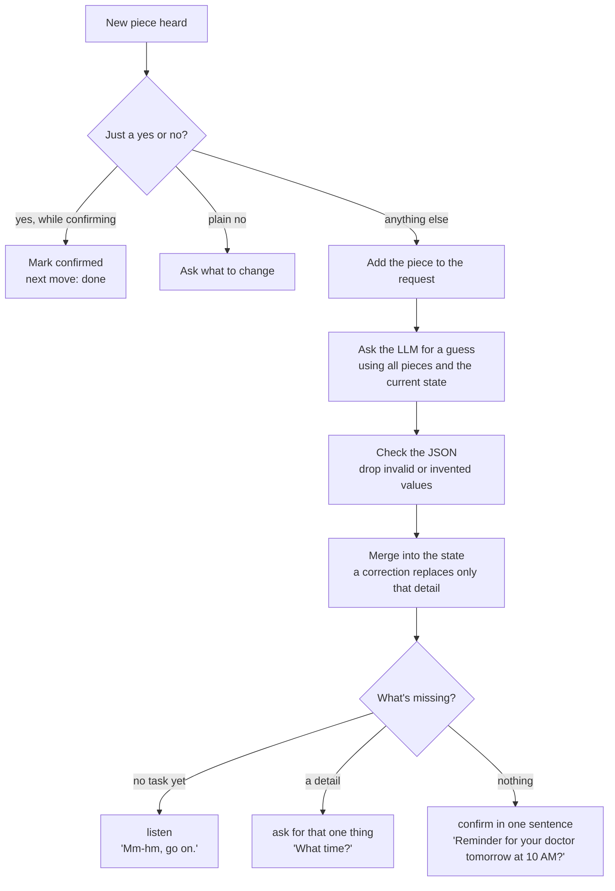

# Brain

The brain lives inside the MCP server. It takes the pieces a person has said, works out what they want, notices corrections, and decides what Alexa does next.

It's built as a plain Python function first, so we can test it by typing, without the simulator.

## The split

**The LLM guesses meaning. Our code enforces the rules.**

- The LLM is great at messy input: mixed-up word order, filler, "no, I mean…". It needs no training data.
- Code is great at being strict: what counts as missing, what to do next, never acting without a yes.

Neither does the other's job.

## One turn inside the brain



Common yes and no words (yeah, yep, mm-hm, right, that's it, nope, no no) are caught by a small word list in code, so they're instant. Anything longer goes to the LLM, because "no, Wednesday" is a correction, not a no.

## Tasks and what each one needs

| Task | Must have | Example | Tier |
| --- | --- | --- | --- |
| Reminder | what, when | tomorrow… doctor… ten | Must |
| Message | who, message text | message Ahmed running late | Must |
| Call | who | call mom | Must |
| Calendar event | title, start time | dinner Friday seven calendar | Should |

These live in one small file as data, so adding a task means adding one entry. When it's unclear whether someone wants a reminder or a calendar event, we pick reminder and let them correct it.

## What the LLM returns

The LLM answers by calling a tool with a fixed JSON schema, through the Bedrock Converse API.

```json
{
  "task": "reminder",
  "details": { "what": "doctor appointment", "when": "2026-09-28T10:00" },
  "changed": [],
  "assumptions": ["ten means 10 AM"],
  "seems_unfinished": false
}
```

- `task` is `reminder`, `message`, `call`, `calendar_event` or `unknown`.
- `changed` lists what a correction changed, like `["when"]` after "no, eleven".
- Dates and times come back in ISO format, and Python checks them.
- If AM or PM is unclear, the LLM picks the likely one and says so in `assumptions`.
- It must never invent details. If something wasn't said, it stays empty.

## The prompt

Short on purpose, because every word costs time. It tells the LLM:

- the current date, time and time zone,
- the person's contacts and nicknames, from the demo profile,
- what we understood before this turn, and every piece said so far,
- the rules: read the pieces together, ignore filler and repeats, let newer values replace older ones, never invent, use ISO dates, say `unknown` if there isn't enough yet.

Memory adds a summary of older conversation and any matching personal words. See [memory.md](memory.md).

## What Alexa says

Replies come from short templates in code, not from the LLM. Templates are fast, predictable and easy to keep short (about 15 words or fewer). Letting the LLM write them would sound more natural, but it's slower and harder to control.

## Mock mode

Mock mode returns recorded LLM answers instead of calling Bedrock. It lets us, and the judges, run everything without an AWS account, and it saves money while we build.

## Model choice

We start with **Nova 2 Lite** or **Claude Haiku 4.5**, whichever works first. Both are fast and support tool use. Because we use the Converse API, switching is a one-line setting. A bake-off between them is a should-have. If the brain scores under 80% on the test set, the bake-off moves to the front of the list.

## Why not Rasa or Lex

Intent frameworks learn from example sentences, and broken speech is too unpredictable for that. They'd need hundreds of broken examples and still miss new ones, and they add setup and delay. An LLM plus a couple hundred lines of Python covers our few tasks, and we can explain every decision.

## Settings

| Variable | What it controls | Starting value |
| --- | --- | --- |
| `BRAIN_MODE` | `bedrock` for the real LLM, `mock` for recorded answers | `mock` |
| `BEDROCK_MODEL_ID` | Which model the brain calls | Nova 2 Lite |
| `AWS_REGION` | The one region we use for everything | where our model is available |
| `PROFILE_PATH` | The demo profile with contacts and time zone | `data/profile.json` |

## Done when

At least 80% of the test set gets the right task and details, and the brain answers in under 2 seconds.
