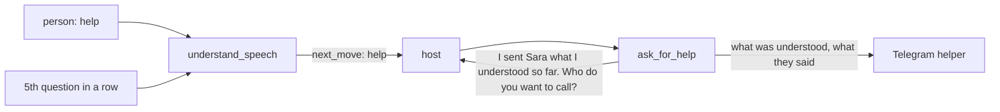

# Branch: feature/ask-for-help

A new tool, `ask_for_help`: the person's helper gets a Telegram message with what Alexa understood so far, so someone can step in. It goes out when the person says "help", or when Alexa still has not understood after `HELP_AFTER_TRIES` questions. The request stays open, so the person can go on where they were.

Builds on [feature/yes-no-mode](feature-yes-no-mode.md) (the count of tries) and on the helpers of [feature/emergency-sos](feature-emergency-sos.md). The page also shows the `speech_trend` sentence now, the open point of [feature/speech-trend](feature-speech-trend.md).

## How it works



- **"help" by itself** (also "help me", "I need help", "get help") answers `next_move: help` and `Okay, I'll ask your helper.` before the brain is asked. Like SOS words, it is decided in code, so it works while the LLM is down. The word is kept as a turn of its own, not as a piece of the request. Two "help"s are still an emergency, as before.
- **Too many questions:** when the brain's answer would be the `HELP_AFTER_TRIES`th question about one request, the reply becomes `next_move: help` with `I'm still not sure, so I'll ask your helper.`; the question itself is kept as the turn, for the tool to repeat. It happens once per request; the person can still say "help" any time.
- **`ask_for_help`** reads the open request and its pieces, writes the message, sends it to every linked helper, saves it as an alert of kind `help`, and says what happened, then repeats the last question, so the person goes on where they were.
- **The message:** `Ahmed asked Alexa for help.` or `Alexa couldn't understand Ahmed after 5 questions.`, then `Understood so far: reminder, when: tomorrow.` (or `Nothing was understood yet.`), `They said: "…"` and the time.
- **Alerts have a kind** now (`sos` or `help`), so a help message never counts against the emergency cooldown.
- **The page** calls `ask_for_help` as soon as `understand_speech` says `help`, and shows and speaks both sentences as one reply. It also shows the `speech_trend` sentence under the conversation, after sign-in and after every finished request.

## Commits

| Commit                                        | What it did                                                                                  |
| --------------------------------------------- | -------------------------------------------------------------------------------------------- |
| `feat: tell emergency and help alerts apart`  | `AlertKind`, the `kind` column (older files repaired), `last_sent_alert` by kind.            |
| `feat: hear a call for help`                  | `HELP_WORDS`, `NextMove.HELP`, the turn for "help" in `understand_speech`.                   |
| `feat: ask the helper after too many tries`   | `HELP_AFTER_TRIES`, the stuck reply, help turns counted as tries (also by `speech_trend`).   |
| `refactor: share sending to helpers between tools` | `notify/helpers.py`: linked helpers, reaching them, the outcome, the names in a sentence.    |
| `feat: add the ask_for_help tool`             | The tool, the message in `HelpText`, the replies, the tool descriptions.                     |
| `feat: the page asks for help when Alexa does`| `takeTurn` calls `ask_for_help` on `help`; the family's hint and the invitation say so.      |
| `feat: show the speech trend on the page`     | One line under the conversation with the `speech_trend` sentence.                            |
| `docs: add ask for help branch notes`         | This page, the README and the task list.                                                     |

## Tests

```bash
uv run pytest tests/test_ask_for_help.py tests/test_notify_helpers.py
cd web && npm test
```

- Which words are a call for help, and which are not ("help help" is SOS, "helpful" is nothing).
- "help" keeps the open request, never reaches the brain, and the next piece goes on with the request.
- The 3rd question (with `help_after_tries=3`) becomes help, once; tries keep counting.
- Over MCP: the helper's message after "tomorrow" then "help"; the stuck message after two unknown pieces with `HELP_AFTER_TRIES=2`; a help message does not delay a later SOS; no helper and unreachable helper.
- The page: a `help` reply calls `ask_for_help` and joins both sentences; the trend is asked for the signed-in person.

## Decisions made on this branch

- **The host calls `ask_for_help`, like it calls `emergency_sos`.** `understand_speech` only decides; sending is a tool of its own, so an AI host can also call it when the person asks in other words.
- **Once per request.** Alexa gives up on her own at exactly the `HELP_AFTER_TRIES`th question, not at every question after it, so the helper is not flooded.
- **Nothing new is stored for the count.** Tries are read from the turns, as before; a help turn counts as a try because it stood where a question would have been.

## Still open

1. **Help needs a Telegram bot.** Without `TELEGRAM_BOT_TOKEN`, the message only goes to the server log, like SOS alerts.
2. **No cooldown for help.** Saying "help" on every turn sends a message on every turn.
