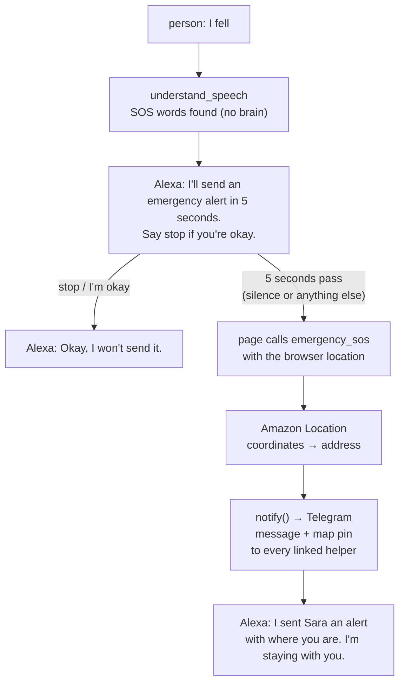

# Branch: feature/emergency-sos

When the person says "I fell", "help help" or "emergency", Alexa counts down 5 seconds and then sends their helpers an alert on Telegram with where they are. Saying "stop" during the countdown cancels it. Silence sends it, so someone who fell and can't speak still gets help.

The helpers are added from the page: the person (or their family) adds a helper, and the helper opens a Telegram link once to start getting alerts.

## What changes



**Who does what:** the browser gives the location, Amazon Location turns it into an address, and Telegram delivers it.

## Before you start

- [x] **Telegram bot:** created with BotFather as `@rana_sra_alerts_bot`. Its token is in `.env` as `TELEGRAM_BOT_TOKEN`, never in git, and `getMe` answers. Each developer uses their own bot (see Decisions: only one server can read a bot's updates).
- [x] **Amazon Location permission:** the IAM user `speech-resilient-alexa` has an inline policy, `LocationReverseGeocode`, that allows only `geo-places:ReverseGeocode`. The SageMaker Geospatial policies are a different service and aren't needed.
- [x] **Amazon Location test:** `ReverseGeocode` answered in under a second for Tahrir Square, Dokki and Nasr City, with readable English addresses ("2 Mohamed Fahmy El Mahdar Street, Cairo"). The label sometimes starts with a nearby place ("Open Air Market, Tahrir Square, Cairo"). Free tier still to check.
- [ ] **Demo helper:** a teammate's phone with Telegram, to get the alert live.

## Steps

### Part 1: the alert, end to end, without Telegram or AWS

- [x] **1. Words:** `SOS_PHRASES` and `STOP_WORDS` in `messages/vocabulary.py`; `asks_for_sos` and `says_stop` in `tools/emergency_sos.py`.
  - SOS: "i fell", "i fall", "fell down", "emergency", "sos", "ambulance", matched anywhere in the piece after dropping punctuation ("uh… i fell… floor"), or "help" said twice or more.
  - A single "help" is not SOS. It stays a normal piece (it belongs to `ask_for_help` later).
  - Stop: "stop", "i'm okay", "i'm ok", "i'm fine", "cancel", "never mind", "don't send", matched as the whole piece: "okay" alone is a yes, not a stop.
- [x] **2. Move:** `NextMove.SOS` in `enums/speech.py` and `web/src/enums.js`. It means "start the countdown". `AlertStatus` (`sent`, `failed`, `no_helper`) next to it.
- [x] **3. Server, `tools/understand_speech.py`:** checked before the brain, so SOS works even when the LLM is down:
  - SOS words found: return `sos`, `countdown_seconds` and the countdown sentence. The turn belongs to no request (`request_id` empty), like switch turns, so an open request is left untouched.
  - The last turn was `sos` (the countdown is running):
    - stop words: no alert. With a request open, Alexa asks its last question again ("Okay, I won't send it. Call Mom?"); with none, she returns `listen` and "Okay, I won't send it. I'm here if you need me."
    - anything else: return `sos` again with a calm line ("Help is coming in a moment."). The page keeps its running countdown.
- [x] **4. Tables:** in `memory/schema.sql`, with their methods in `memory/store.py` and `memory/sqlite.py`. `emergency_sos` needs all three, so `profiles` and `helpers` moved here from Part 2:
  - `profiles`: `user_id`, `name` (for "SOS from Ahmed"), `home_address` (sent when the browser gives no location). `save_profile`, `profile`.
  - `helpers`: `id`, `user_id`, `name`, `link_code` (unique), `telegram_chat_id` (empty until linked), `linked_at`, `created_at`. `add_helper`, `helpers`, `link_helper`.
  - `alerts`:

    | Column       | What it holds                            |
    | ------------ | ---------------------------------------- |
    | `id`         | the alert                                |
    | `user_id`    | the person                               |
    | `heard`      | what was said from the SOS words on      |
    | `latitude`   | from the browser, empty if unknown       |
    | `longitude`  | from the browser, empty if unknown       |
    | `address`    | from Amazon Location, empty if it failed |
    | `text`       | the message the helpers got              |
    | `status`     | `sent`, `failed` or `no_helper`          |
    | `created_at` | when it was sent                         |

    `add_alert`, `last_sent_alert`, `alerts`.
- [x] **5. `notify()`:** the `mcp-server/notify/` package, the one way messages leave the server, as `TASKS.md` asks:
  - `base.py`: `Notifier` with `notify(helper, text, position=None)`, which raises when the helper can't be reached.
  - `simulated.py`: writes the alert to the server log instead of sending it.
  - `factory.py`: Telegram when `TELEGRAM_BOT_TOKEN` is set, the log otherwise, like `brain/factory.py` picks the mock brain.
- [x] **6. Tool, `tools/emergency_sos.py`:** `emergency_sos(user_id, latitude=None, longitude=None)`. Sends right away, with no countdown and no yes: the countdown happens before it is called.
  - The alert: "🚨 SOS from {name}.", what they said during the countdown, a Google Maps link (or the home address, or "Location unknown."), and the time.
  - Sends to every linked helper through `notify()`. One helper's channel failing doesn't stop the others.
  - Saves the alert. A sent alert in the last 2 minutes is not sent again; Alexa says she already sent it. A failed one can be tried again at once.
  - No linked helper: says so plainly and points to the emergency number, and saves `no_helper`.
  - Ends with a `listen` turn, which ends the countdown, so the next piece is heard as usual.
- [x] **7. Texts:** Alexa's lines in `messages/replies.py`, the alert's lines in `messages/alerts.py`, the tool's description in `messages/tools.py`.
- [x] **8. Settings:** `SOS_COUNTDOWN_SECONDS` (5) and `SOS_COOLDOWN_MINUTES` (2) in `config/settings.py` and `.env.example`.
- [x] **9. Page, countdown:** `web/src/sos.js`, tested alone like `pause.js`:
  - `sos`: arm the countdown and start reading the location. It starts counting when Alexa finishes the sentence, because the mic is off while she talks.
  - any other move: clear it.
  - when it ends: `main.js` queues the alert behind the turns already sent, so a "stop" said just before the end still cancels it. Then it calls `emergency_sos` with the location and speaks the reply.
  - a big red banner counts down on screen.
- [x] **10. Browser location, `web/src/position.js`:** read when the countdown starts, with a 4 second timeout and a position up to a minute old allowed. A refused or failed location sends the alert without one. `localhost` counts as a secure page, so the browser allows it.
- [x] **11. No location:** the alert gives the home address from the profile. No home address either: "Location unknown."

### Part 2: Telegram and helpers

- [x] **12. Telegram notifier, `notify/telegram.py`:** `TelegramBot` makes plain HTTPS calls to the Bot API with a short timeout. `TelegramNotifier` sends the alert with `sendMessage`, then the map pin with `sendLocation`; a pin that fails is logged, and the alert still counts as sent.
- [x] **13. Linking helpers:** `HelperLinker` runs in a background thread started in the server's lifespan, on its own database connection. It reads the bot's messages (`getUpdates`, long polling), so it works on localhost with no public URL.
  - `/start <link_code>` from a helper: `link_helper` saves their `telegram_chat_id`, and the bot replies "You're linked as Sara."
  - `/start` with no code or a wrong one: the bot says the link doesn't work.
  - A used link can't be taken by another chat; the same helper opening it again is fine.
- [x] **14. Routes, `people/routes.py`:** plain HTTP routes next to `/speak`, not MCP tools (see Decisions):
  - `GET /profile` and `PUT /profile`: the person's name and home address.
  - `POST /helpers`: a helper's name. Returns the link `https://t.me/<bot>?start=<link_code>`.
  - `GET /helpers`: the helpers, whether each one is linked, and whether Telegram is set up.
  - `DELETE /helpers/{id}`: remove a helper, only one of this person's.
  - Since [feature/sign-in](feature-sign-in.md), every one of them needs a signed-in account, and the person comes from the session, not from the request.
  - CORS now allows `PUT` for the page.
- [x] **15. Settings:** `TELEGRAM_BOT_TOKEN`, `TELEGRAM_API_URL`, `TELEGRAM_POLL_SECONDS`, `TELEGRAM_TIMEOUT_SECONDS` in `config/settings.py` and `.env.example`. The bot's username comes from `getMe` the first time a link is needed.
- [x] **16. Page, helper setup:** a **People who help me** part at the bottom of `web/index.html`, in `web/src/setup.js` and `web/src/people.js`:
  - the home address. The name in the alert is the name on the person's account.
  - add a helper by name, and show their link. **Copy invitation** copies a ready message for the helper (who added them, open the link, press Start); on a phone, **Share invitation** sends it straight to WhatsApp or Messages.
  - the list of helpers, showing "waiting" until they press Start, then "linked" (checked every 3 seconds while someone is waiting).
  - **Allow location for emergencies** asks for the browser's permission here, so the prompt never pops up during an emergency.
  - Not done: a QR code for the link. It needs a QR package in `web/`.

### Part 3: the address

- [x] **17. Address, `mcp-server/location/`:** `AmazonLocationGeocoder` calls `ReverseGeocode` (the `geo-places` client; the position is longitude first), with one try and a 2 second timeout. Any failure gives no address, and the alert goes with the map link only. The alert reads "Where: {address}" then "Map: {link}", and the address is saved in `alerts.address`. `LOCATION_ENABLED`, `LOCATION_LANGUAGE` and `LOCATION_TIMEOUT_SECONDS` in settings.

### Part 4: if there's time

- [ ] **18. "I'm on my way":** a button under the alert in Telegram. The same update reader saves who pressed it on the alert. After sending, the page asks `GET /sos/status` every few seconds, and Alexa says "Sara saw your alert and is on her way." This is the strongest demo moment.

### Finish

- [x] **19. Tests (Parts 1 to 3):** see below.
- [x] **20. Try it (Part 1):** in the page, with Alexa muted and a helper added straight in the database: "uh… I fell" showed the countdown and, after 5 seconds, the alert went out (in the server log) and Alexa said "I sent Sara an alert." "help help" right after said it was already sent. "emergency" then "stop" sent nothing.
- [ ] **21. Try it (all):** link a teammate's Telegram, say "I fell" and wait: their phone gets the message and the pin. Then say "help help" and "stop": nothing is sent.
- [ ] **22. Docs:** tick `emergency_sos` in `TASKS.md`, and add the alerts, profiles and helpers tables to `docs/memory.md`.

## Decisions

- **Tests never reach Telegram or AWS.** `tests/conftest.py` starts every server with no bot token and Amazon Location off. The Telegram tests run a fake Bot API on localhost, and the Location tests use a fake `geo-places` client.

- **A countdown, not a yes.** A yes protects from false alarms, but someone who fell may not be able to say it. The countdown protects from false alarms too, and silence still sends.
- **The countdown lets the trigger words be loose.** The speech is broken, so the words must match even when said badly. A false match costs one "stop", not an alert.
- **"no" doesn't stop it.** A missed stop only sends an alert; a wrong stop leaves someone without help. So only clear words stop the countdown.
- **Words, not the brain.** SOS is checked with a fixed list before the brain. It works with no LLM, no internet to the LLM, and no budget.
- **The countdown lives in the page.** The page already plays Alexa's part (`takeTurn` in `mcp.js`), it has the location, and it can speak when the time is up. The server cannot reach the page on its own. `emergency_sos` itself sends at once, so a real Alexa+ host can call it directly.
- **The countdown starts when Alexa stops talking.** The mic is off while she talks, so counting from her first word would leave about one second to say stop.
- **Every linked helper at once.** No waiting for the first one to answer before trying the next, so no timer is needed.
- **Telegram, not SMS.** SMS to Egypt through AWS needs a registered sender ID with official papers, and new accounts are limited to $1 a month in a sandbox. WhatsApp needs a Meta Business account and approved templates. Telegram is free, rings at once and shows a map pin. Because everything goes through `notify()`, SMS or email can be added later without touching the tool.
- **The helper opens the link.** A Telegram bot can only message someone who pressed Start. That step also means the helper agreed to get alerts.
- **Setup is routes, not MCP tools.** Adding helpers is done once by the family on a screen, not said to Alexa. It stays out of the tools an AI host chooses from.
- **The alert never waits for AWS.** Amazon Location only adds the address. If it's slow or fails, the pin goes without it.
- **One update reader per bot.** Telegram gives a bot's updates to one reader. Two servers on the same token would take each other's `/start` messages, so each developer uses their own bot.
- **Not a replacement for emergency services.** When no helper is linked, or every channel fails, Alexa says so plainly and points to the emergency number.

## Still open

- **The brain as a second line?** Phrases not in the list ("I'm on the floor", "I can't get up") are missed. The brain could flag an emergency and start the same countdown. Not decided. Today the brain's schema already lists `sos` among the moves (every `NextMove` is in it), but its prompt never mentions it.
- **Medical info in the alert?** Illnesses and medicines would help whoever arrives. Not decided.
- **If the page closes during the countdown,** nothing is sent.
- ~~**No sign-in on the setup routes.**~~ Done on [feature/sign-in](feature-sign-in.md): the setup routes need a signed-in account.
- **Calm replies after the alert.** The next turns go through the normal flow.

## Tests

```bash
uv run pytest tests/test_emergency_sos.py
uv run pytest
uv run ruff check mcp-server tests
cd web && npm test
```

Part 1:

- SOS words start the countdown, also inside broken pieces; a single "help" or "I feel" does not.
- SOS works with the brain failing.
- "stop" during the countdown goes back to the open request, untouched, and a yes then carries it out.
- "okay" alone, "please hurry" and more SOS words keep the countdown going.
- `emergency_sos` sends to every linked helper with the map link; without a location it gives the home address, or "Location unknown."
- After the alert, the next piece is heard as usual.
- A second alert within 2 minutes is not sent; a failed one can be retried; no linked helper says so.
- One failing helper doesn't stop the others; all failing says so.
- Page: the countdown waits for Alexa, counts down and sends; another move clears it, even after the end if the alert hasn't left; more `sos` replies don't restart it; the location is read once (fake timers).

Parts 2 and 3 (`tests/test_telegram.py`, `tests/test_location.py`):

- A new helper gets a link to the bot; opening it links them and the bot says so; a wrong link links nobody; a used link can't be taken by another chat.
- The alert reaches the helper on Telegram with a map pin; a missing pin still counts as sent; Telegram refusing the alert makes Alexa say so.
- Without a bot token, helpers get no link and the page is told Telegram isn't set up.
- The profile is saved and read back; missing fields are refused; a helper can only be removed by their own person; the page may send `PUT` from another port.
- The address label comes back with the position longitude first; no result or an AWS error gives no address; the alert then still goes with the map.
