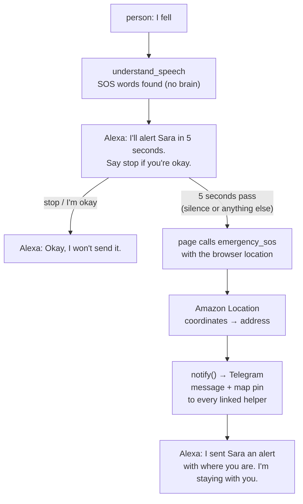

# Branch: feature/emergency-sos

When the person says "I fell", "help help" or "emergency", Alexa counts down 5 seconds and then sends their helpers an alert on Telegram with where they are. Saying "stop" during the countdown cancels it. Silence sends it, so someone who fell and can't speak still gets help.

The helpers are added from the page: the person (or their family) adds a helper, and the helper opens a Telegram link once to start getting alerts.

## What changes



**Who does what:** the browser gives the location, Amazon Location turns it into an address, and Telegram delivers it.

## Before you start

- [ ] **Telegram bot:** create one with BotFather. Put its token in `.env` as `TELEGRAM_BOT_TOKEN`, never in git. Each developer uses their own bot (see Decisions: only one server can read a bot's updates).
- [ ] **Amazon Location:** give the IAM user `speech-resilient-alexa` `geo-places:ReverseGeocode`. Test it on the account with a real coordinate from where the demo will be, and check the address that comes back reads well. Check the free tier too.
- [ ] **Demo helper:** a teammate's phone with Telegram, to get the alert live.

## Steps

### Part 1: the alert, end to end, without Telegram or AWS

- [ ] **1. Words:** add `SOS_WORDS` and `STOP_WORDS` to `messages/vocabulary.py`.
  - SOS: "i fell", "i fall", "fell down", "emergency", "sos", "help help", "help me help", "ambulance". The speech is often broken, so match a phrase anywhere in the piece ("uh… i fell… floor"), and a single "help" repeated twice or more.
  - A single "help" is not SOS. It stays a normal piece (it belongs to `ask_for_help` later).
  - Stop: "stop", "i'm okay", "i'm ok", "i'm fine", "cancel", "never mind", "don't send". Match whole phrases: "okay" alone is a yes, not a stop.
- [ ] **2. Move:** add `NextMove.SOS` to `enums/speech.py` and `web/src/enums.js`. It means "start the countdown".
- [ ] **3. Server, `tools/understand_speech.py`:** check before the brain, so SOS works even when the LLM is down:
  - SOS words found: return `sos` with the countdown sentence. The turn belongs to no request (`request_id` empty), like switch turns, so an open request is left untouched.
  - The last turn was `sos` and no alert was sent after it:
    - stop words: return `listen` with "Okay, I won't send it. I'm here if you need me."
    - anything else: return `sos` again with a calm line ("Help is coming in a moment."). The page keeps its running countdown.
- [ ] **4. Alerts table:** add `alerts` to `memory/schema.sql`:

  | Column         | What it holds                                  |
  | -------------- | ---------------------------------------------- |
  | `id`           | the alert                                      |
  | `user_id`      | the person                                     |
  | `heard`        | the words that started it                      |
  | `latitude`     | from the browser, empty if unknown             |
  | `longitude`    | from the browser, empty if unknown             |
  | `address`      | from Amazon Location, empty if it failed       |
  | `status`       | `sent`, `failed` or `no_helper`                |
  | `created_at`   | when it was sent                               |

  Add `add_alert` and `last_alert` to `memory/store.py` and `memory/sqlite.py`.
- [ ] **5. `notify()`:** a new `mcp-server/notify/` package, the one way messages leave the server, as `TASKS.md` asks:
  - `base.py`: `Notifier` with `notify(helper, text, location=None)`.
  - `simulated.py`: keeps what it would send in a list, for the tests and when there's no token.
  - `factory.py`: Telegram when `TELEGRAM_BOT_TOKEN` is set, simulated otherwise, like `brain/factory.py` picks the mock brain.
- [ ] **6. Tool, `tools/emergency_sos.py`:** `emergency_sos(user_id, latitude=None, longitude=None)`. Sends right away, with no countdown and no yes: the countdown happens before it is called.
  - Writes the alert text: "🚨 SOS from {name}. They said: "{heard}". {time}. {address}."
  - Sends to every linked helper through `notify()`.
  - Saves the alert. An alert in the last 2 minutes is not sent again; Alexa says she already alerted them.
  - No linked helper: says so plainly ("I can't reach anyone yet. Please call the emergency number."), and saves `no_helper`.
  - Register it in `server.py` with `ToolDescription.EMERGENCY_SOS`: "Call this right away when the person says they fell, are hurt or need emergency help. Pass the location if you have it."
- [ ] **7. Texts:** countdown, stopped, calm line, sent, already sent and no helper in `messages/replies.py`.
- [ ] **8. Settings:** `SOS_COUNTDOWN_SECONDS` (5) and `SOS_COOLDOWN_MINUTES` (2) in `config/settings.py` and `.env.example`.
- [ ] **9. Page, countdown:** a new `web/src/sos.js`, tested alone like `pause.js`:
  - `sos`: start the countdown if none is running. Never restart a running one.
  - any other move: clear the countdown.
  - when it ends: call `emergency_sos` with the location, and speak the reply.
  - `mcp.js`: add `Tool.EMERGENCY_SOS`. `main.js`: show the countdown on screen too, as big as possible.

### Part 2: Telegram and helpers

- [ ] **10. Tables:** add to `memory/schema.sql`:
  - `profiles`: `user_id`, `name` (for "SOS from Ahmed"), `home_address` (sent when the browser gives no location).
  - `helpers`: `id`, `user_id`, `name`, `link_code` (unique), `telegram_chat_id` (empty until linked), `linked_at`, `created_at`.
- [ ] **11. Telegram notifier, `notify/telegram.py`:** `sendMessage` with the alert text and a Google Maps link, then `sendLocation` for the map pin. Plain HTTPS calls to the Bot API, with a short timeout.
- [ ] **12. Linking helpers:** a background task started in the server's lifespan reads the bot's updates (`getUpdates`, long polling), so it works on localhost with no public URL.
  - `/start <link_code>` from a helper: save their `telegram_chat_id` and reply "You'll now get alerts from {name}."
  - `/start` with no code or a wrong one: reply that the link is not valid.
- [ ] **13. Routes:** plain HTTP routes next to `/speak`, not MCP tools (see Decisions):
  - `PUT /profile`: the person's name and home address.
  - `POST /helpers`: a helper's name. Returns the link `https://t.me/<bot>?start=<link_code>`.
  - `GET /helpers?user_id=`: the helpers, and whether each one is linked yet.
  - `DELETE /helpers/{id}`: remove a helper.
- [ ] **14. Settings:** `TELEGRAM_BOT_TOKEN`, `TELEGRAM_POLL_SECONDS` in `config/settings.py` and `.env.example`. The bot's username comes from `getMe` at startup.
- [ ] **15. Page, helper setup:** a "People who help me" part in `web/index.html`:
  - the person's name and home address.
  - add a helper by name. Show their link, and a QR code for a phone to scan.
  - the list of helpers, showing "waiting" until they press Start, then "linked".
  - ask for the browser's location permission here, so the prompt never pops up during an emergency.

### Part 3: location

- [ ] **16. Browser:** in `sos.js`, read the location when the countdown starts, with a short timeout and a recent cached position allowed, so it's ready when the 5 seconds end. `localhost` counts as a secure page, so the browser allows it.
- [ ] **17. Address, `mcp-server/location/`:** Amazon Location `ReverseGeocode` (the `geo-places` client; the position is longitude first). A 2 second timeout. Any failure: send the pin without an address. `LOCATION_TIMEOUT_SECONDS` (2) in settings.
- [ ] **18. No location:** use the home address from the profile. No home address either: "Location unknown".

### Part 4: if there's time

- [ ] **19. "I'm on my way":** a button under the alert in Telegram. The same update reader saves who pressed it on the alert. After sending, the page asks `GET /sos/status` every few seconds, and Alexa says "Sara saw your alert and is on her way." This is the strongest demo moment.

### Finish

- [ ] **20. Tests:** see below.
- [ ] **21. Try it:** link a teammate's Telegram, say "I fell" and wait: their phone gets the message and the pin. Then say "help help" and "stop": nothing is sent.
- [ ] **22. Docs:** tick `emergency_sos` in `TASKS.md`, and add the alerts, profiles and helpers tables to `docs/memory.md`.

## Decisions

- **A countdown, not a yes.** A yes protects from false alarms, but someone who fell may not be able to say it. The countdown protects from false alarms too, and silence still sends.
- **The countdown lets the trigger words be loose.** The speech is broken, so the words must match even when said badly. A false match costs one "stop", not an alert.
- **Words, not the brain.** SOS is checked with a fixed list before the brain. It works with no LLM, no internet to the LLM, and no budget.
- **The countdown lives in the page.** The page already plays Alexa's part (`takeTurn` in `mcp.js`), it has the location, and it can speak when the time is up. The server cannot reach the page on its own. `emergency_sos` itself sends at once, so a real Alexa+ host can call it directly.
- **Every linked helper at once.** No waiting for the first one to answer before trying the next, so no timer is needed.
- **Telegram, not SMS.** SMS to Egypt through AWS needs a registered sender ID with official papers, and new accounts are limited to $1 a month in a sandbox. WhatsApp needs a Meta Business account and approved templates. Telegram is free, rings at once and shows a map pin. Because everything goes through `notify()`, SMS or email can be added later without touching the tool.
- **The helper opens the link.** A Telegram bot can only message someone who pressed Start. That step also means the helper agreed to get alerts.
- **Setup is routes, not MCP tools.** Adding helpers is done once by the family on a screen, not said to Alexa. It stays out of the tools an AI host chooses from.
- **The alert never waits for AWS.** Amazon Location only adds the address. If it's slow or fails, the pin goes without it.
- **One update reader per bot.** Telegram gives a bot's updates to one reader. Two servers on the same token would take each other's `/start` messages, so each developer uses their own bot.
- **Not a replacement for emergency services.** When no helper is linked, Alexa says so plainly and points to the emergency number.

## Still open

- **Medical info in the alert?** Illnesses and medicines would help whoever arrives. Not decided.
- **If the page closes during the countdown,** nothing is sent.
- **No sign-in on the setup routes.** Any page on an allowed origin can add a helper for any `user_id`. Fine for the demo, not for real use.
- **Calm replies after the alert.** The next turns go through the normal flow.

## Tests

```bash
uv run pytest tests/test_emergency_sos.py
uv run pytest
uv run ruff check mcp-server tests
cd web && npm test
```

- SOS words start the countdown, also inside broken pieces; a single "help" does not.
- SOS works with the brain failing.
- An open request is untouched by the countdown and still there after "stop".
- Stop words during the countdown stop it; "okay" alone does not; other words keep it going.
- `emergency_sos` sends to every linked helper, with the address when Location answers and without it when Location fails or is slow.
- A second alert within 2 minutes is not sent; no linked helper says so.
- `/start` with a valid code links the helper; a wrong code does not (a fake Telegram, no network).
- Page: `sos` starts the countdown once; another move clears it; the end calls `emergency_sos` with the location (fake timers).
