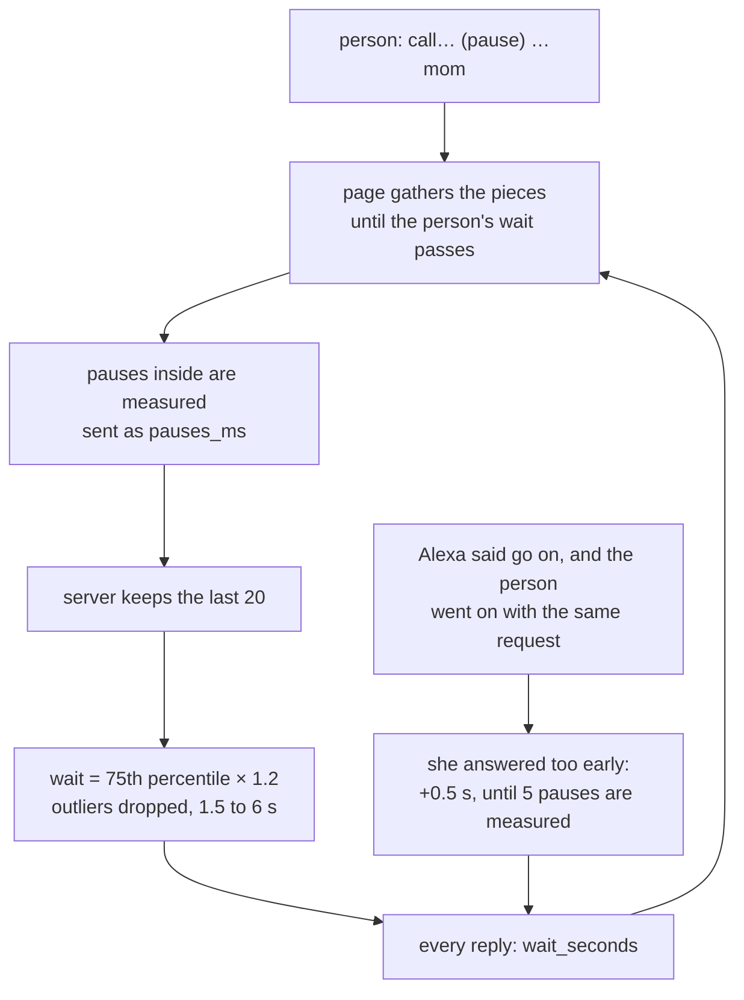

# Branch: feature/learn-pauses

Alexa learns how long each person pauses in the middle of a sentence, and waits that long before she answers. Speech recognition ends a piece at every short pause, and the page used to answer each piece at once, so Alexa jumped in ("Mm-hm, go on") while the person was still thinking. Now she adapts to the person, not the other way around.

## How she learns



1. **She answered too early.** Alexa said "Mm-hm, go on" (`listen`) and the next piece continued the same request: she spoke before the person had finished. Until enough pauses are measured, each time adds 0.5 s to that person's wait.
2. **She waited, so she can measure.** Pieces said within the wait are joined into one turn, and the page measures each pause between them: from the end of one piece to the moment the person starts talking again. They go to the server as `pauses_ms`.
3. **From 5 measured pauses on,** the wait comes from them: the last 20, without pauses over 10 s (a cough, someone talking to them), without outliers (the IQR rule), then the 75th percentile of what's left, times 1.2. Always between 1.5 and 6 s; a new person starts at 2 s.

## What was built

- **Settings, `PAUSE_*`:** the start, the limits, the step, the 10 s cut-off, how many pauses to keep, how many are enough, the margin.
- **Memory:** `pauses` (each measured pause) and `pause_waits` (the wait grown by early answers) in `memory/schema.sql`.
- **`pacing/learning.py`:** `wait_from_pauses` (the rule above) and `Pacing`, which learns and answers each person's wait.
- **`understand_speech`:** takes `pauses_ms`, learns from it and from early answers, and returns `wait_seconds` in every reply. A real Alexa+ host can use the same fields. `/me` and sign-in return the wait too, so the page has it from the first turn.
- **Page, `web/src/gather.js`:** gathers spoken pieces until the wait passes; partial words hold the answer while the person is talking; typed words, and "stop" during an SOS countdown, go at once.

## Decisions

- **Learned on the server, per account.** The same person on another device keeps their wait, and an AI host can use it.
- **The 75th percentile, not the average.** One long pause doesn't pull it, and it still covers most pauses.
- **Early answers only count until there are measurements.** They show the wait is too short, but not by how much; measured pauses do.
- **A hard ceiling of 6 s.** Waiting longer feels like being ignored.

## Still open

- **An SOS phrase waits too.** "I fell" said by voice starts the countdown after the person's wait, at most 6 s later. "stop" during the countdown goes at once. Checking the SOS words in the page would mean a second copy of the word list.

## Tests

```bash
uv run pytest tests/test_pacing.py
cd web && npm test
```

- Fewer than 5 pauses give no measured wait; 5 give the 75th percentile with the margin; one odd long pause changes nothing; pauses over 10 s don't count; the wait stays within its limits.
- A new person waits 2 s; each early answer adds 0.5 s up to 6 s; measured pauses take over; only the latest 20 count.
- Going on after "go on" counts as early; a new request after a finished one doesn't; the host's pauses are stored and learned; every MCP reply and `/me` carry the wait.
- Page: one piece goes after the wait and not before; pieces within the wait go together with their pauses; talking again holds the answer; a piece that never finishes still goes; "immediate" skips the wait.
