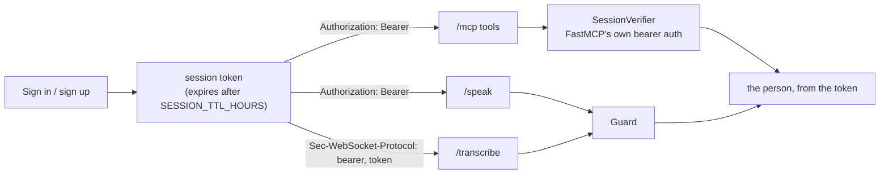

# Branch: feature/mcp-auth

The sign-in now protects everything, not only the profile and helpers pages. Every MCP tool call, the `/speak` route and the `/transcribe` socket carry the person's session token, and the server takes the person from that token. No tool takes a `user_id` any more, so nobody can read another person's memory or fire their emergency alert by typing a username.

## The gap before

The login guarded `/profile` and `/helpers`, but the MCP tools trusted whatever `user_id` the browser sent. The same was true of `/speak` (anyone could spend our Polly credits) and `/transcribe`.

## What changes



## Commits

| Commit                                                   | What it did                                                                                   |
| -------------------------------------------------------- | --------------------------------------------------------------------------------------------- |
| `feat: expire sign-in sessions`                          | `sessions.expires_at`, `SESSION_TTL_HOURS` (30 days), and one `Sessions` service that opens, checks and closes them. Old databases get the column on start-up. |
| `feat: take the person from the sign-in token in every tool` | `SessionVerifier`, FastMCP's `TokenVerifier` over our sessions. `FastMCP(auth=...)` answers 401 without a valid token; each tool reads the person with `get_access_token().subject`. |
| `feat: guard the speak and transcribe routes`            | One `Guard` used by the people routes, `/speak` and `/transcribe`. The socket carries the token as a subprotocol, since browsers can't set headers on WebSockets. |
| `feat: send the sign-in token on every call from the page` | `mcp.js` reconnects when the token changes; `polly.js` and `transcribe.js` take a token getter; no more `user_id` arguments. |
| `docs: add mcp auth branch notes`                        | This page, the README and the task list.                                                      |

## Tests

```bash
uv run pytest tests/test_sessions.py tests/test_mcp_auth.py tests/test_speak.py tests/test_server.py
cd web && npm test
```

- A tool call with no token, a made-up token or a signed-out token gets `401`; the tools' input schemas have no `user_id`; two signed-in people never see each other's pieces.
- `/speak` without a token is `401`; the socket refuses a stranger and opens for a signed-in person.
- Sessions expire (`SESSION_TTL_HOURS=0` is refused at once) and belong to their company.
- Every older test signs in through `tests/support.py:token_for`, which creates the account the first time.

Checked in Chrome against the mock brain: sign up on the page, three turns over `/mcp` with the token, `/speak` reached with the token (503 without AWS, so the browser voice spoke), the mic socket opened and fell back to the browser's recognition.

## Decisions made on this branch

- **FastMCP's own auth, not a home-made check.** `TokenVerifier` is the hook FastMCP gives for bearer tokens, so the 401, the `WWW-Authenticate` header and the token in the tool context come for free, and an OAuth provider (Descope) can replace `SessionVerifier` later without touching the tools.
- **The person comes only from the token.** The plan's `user_id` parameter is gone. A real Alexa+ host would hold the token for the Amazon account; the page holds it for the family.
- **The token also guards the voice routes.** Polly costs money and Transcribe streams audio; neither should be open to anyone who finds the port.
- **Sessions last 30 days by default.** Typing is hard for the people this is for, so the family signs in once. It is one setting.

## Still open

1. **MCP Inspector needs a token now.** The README shows the one `curl` to get it.
2. **Rate limiting on `/signin`.** The check takes the same time for a wrong username and a wrong password, but nothing slows down a brute-force attempt.
3. **Descope.** When it comes, it replaces `SessionVerifier` and the `/signin` route; the tools stay as they are.
