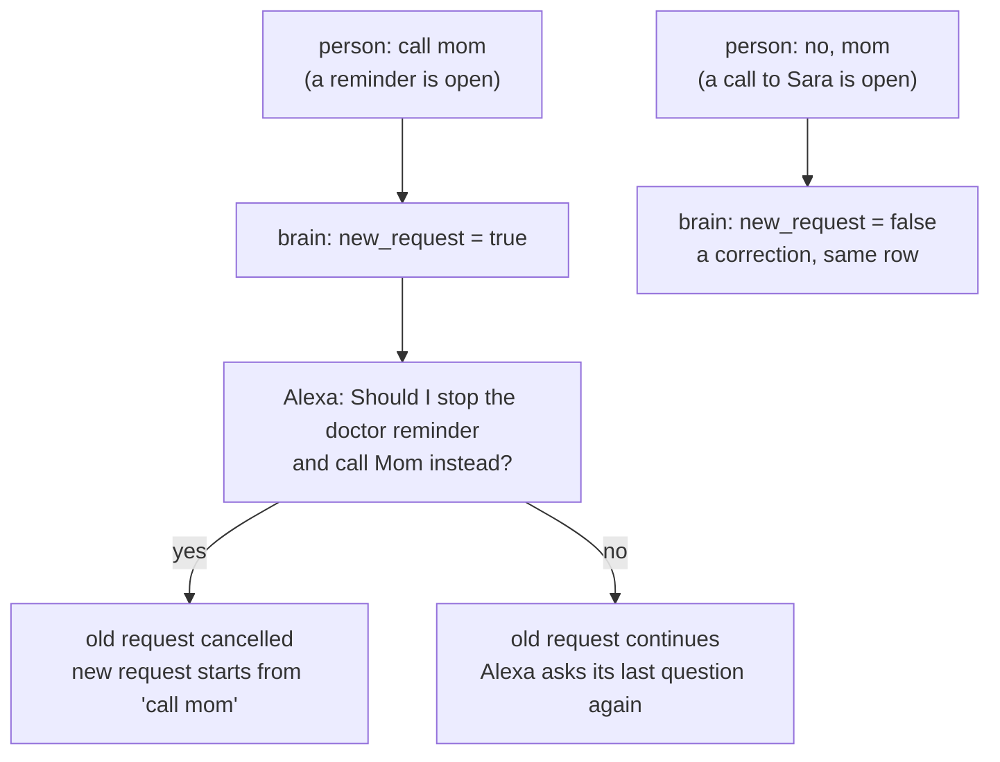

# Branch: feature/new-request

When the person starts something new while a request is still open, Alexa asks before switching, so two requests never get merged into one row. This comes before [usual requests](feature-usual-requests.md), which learns from the rows: if "call mom" gets merged into a reminder, the counts are wrong.

## The problem before

A request stays open while its status is `pending` or `confirmed`. Every new message was added to it, whatever it said. The brain was told the pieces belong together and had no way to say "this is new", so "call mom" in the middle of a reminder overwrote the reminder on the same row.

## What changes



## Steps

- [x] **1. Brain output:** add `new_request: bool = False` to `BrainResult` (`brain/schemas.py`).
- [x] **2. Prompt:** in `messages/prompts/understand_speech.txt`, explain the difference:
  - a **correction** changes a detail of the same request: "no, mom", "not ten, nine".
  - a **new request** asks for something that doesn't fit the open one: "call mom" during a reminder.
  - set `new_request` only for a new one, and only when the open request already has a clear intent.
- [x] **3. Server:** in `tools/understand_speech.py`:
  - `new_request` is true: don't touch the open request. Ask the switch question and save the turn with a new move, `NextMove.SWITCH`, and no request.
  - the last turn was `switch` and the person says yes: cancel the old request, start a new one, and interpret the saved piece on its own.
  - the last turn was `switch` and the person says no: keep the old request and ask its last question again.
  - anything else: handled as usual on the open request. Only a yes switches.
- [x] **4. Texts:** the "back to it" reply in `messages/replies.py`. The switch question itself comes from the brain.
- [x] **5. Mock brain:** add the "call mom during a reminder" example to `data/mock_answers.json`, so the tests run without an API key.
- [x] **6. Tests:** `tests/test_new_request.py`, over HTTP with the mock brain.
- [x] **7. Try it:** checked with the real brain (Groq): switch then yes, switch then no, and a correction.

## Decisions

- **Ask, don't guess.** With broken speech a correction and a new request can sound alike. If the brain guesses wrong, the person loses what they said. Asking costs one turn and drops nothing without a yes.
- **The brain writes the switch question.** It has to name both requests ("the doctor reminder", "call Mom"), which a fixed template can't do well. A yes drops the open request, so the prompt tells it to say "stop", not "keep".
- **Switch turns belong to no request.** Their `request_id` is empty, so "call mom" never reaches the brain as a piece of the old request, even after a no. The new piece is that turn's `heard`, so no new table is needed.
- **No history when switching.** After a yes, the brain reads the new piece without the history. The history shows the dropped request with its question unanswered, and with it the brain asked to switch again, in a loop.
- **The yes itself is not saved as a turn.** The piece ("call mom") becomes the first turn of the new request, because the brain reads a request's pieces from its turns.

## Tests

```bash
uv run pytest tests/test_new_request.py
uv run pytest
uv run ruff check mcp-server tests
```

- A correction stays in the same request.
- A new request asks first and leaves the open one untouched.
- Yes cancels the open request and starts the new one, which can then be carried out.
- No keeps the open request, asks its question again, and a yes then carries it out.
