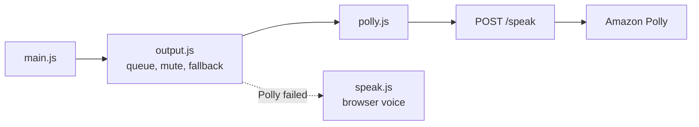

# Branch: feature/polly-voice

Alexa's replies are spoken by **Amazon Polly** first, through the server, and by the browser's own voice when Polly can't be reached. It builds on `feature/voice-output` and mirrors how the microphone already works: Amazon Transcribe first, the browser as fallback.

## Commits

| Commit                                   | What it did                                                                                    |
| ---------------------------------------- | ---------------------------------------------------------------------------------------------- |
| `feat: add Polly settings`               | `POLLY_PATH`, `POLLY_VOICE_ID`, `POLLY_ENGINE`, `POLLY_OUTPUT_FORMAT`; engine and format are enums. |
| `feat: synthesize speech with Polly`     | `speech/polly.py` turns text into audio bytes behind the `Synthesizer` protocol.               |
| `feat: add the speak route`              | `POST /speak` with `{"text"}` returns audio, `400` without text, `503` when Polly is unavailable. |
| `refactor: split voices from the output` | `web/src/output.js` queues, mutes and falls back; a voice only speaks and stops.               |
| `feat: speak with Polly in the page`     | `web/src/polly.js` plays the server's audio; the browser voice is next in line.                |

## How it fits together



The AWS credentials stay on the server. The page only sends text and receives audio.

## Tests

```bash
uv run pytest tests/test_polly.py tests/test_speak.py
cd web && npm test
```

- `test_polly.py` checks the exact request to Polly with botocore's `Stubber`, and the real service when AWS credentials are present.
- `test_speak.py` calls the route over HTTP: empty text, invalid credentials (`503`), and real audio when credentials are present.
- The web tests use a fake `fetch` and `Audio` with the real shapes, and fake voices to check the order, fallback and mute logic of `output.js`.

## Decisions made on this branch

- **Same fallback shape as the microphone.** Polly first, browser second, and the page never shows an error for it. Polly is tried again on every reply, so a short outage costs one reply, not the session.
- **A voice is tiny.** `speak(text)` resolves when done, rejects when it couldn't start; `stop()` cuts it. Everything else lives in `output.js`, once.
- **Server-side synthesis.** Keeps the AWS keys off the page and lets any other client reuse `/speak`.
- **Audio is streamed, not stored.** Each reply is one object URL, revoked right after it plays.

## Still open

1. **Latency.** Polly adds one round trip per reply. Neural voices are quick; the generative engine is slower.
2. **The Polly client is built at start-up.** It fails lazily on the first call, which is what the fallback needs, but a credentials check at start-up would tell the operator sooner.
3. **Checked in Chrome only.**
