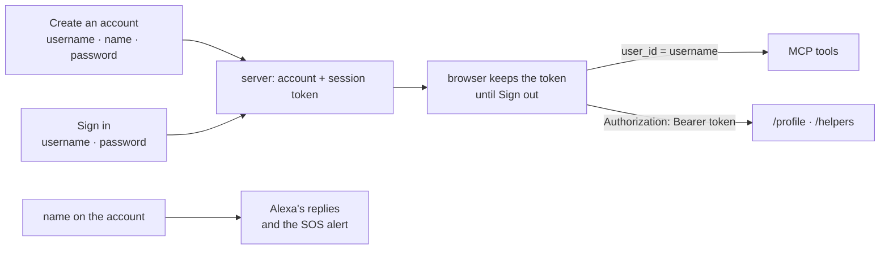

# Branch: feature/sign-in

The page asks for a username and password, like any site, instead of a "User ID" box. Each person has their own account, so two people called Rana never share a memory, and Alexa calls the person by the name on it.

Builds on [feature/emergency-sos](feature-emergency-sos.md): the setup routes for helpers now need a signed-in account.

## What changes



## What was built

- **Accounts, `memory/schema.sql`:** `accounts` (one per person, the password as a scrypt hash) and `sessions` (one per signed-in browser, only a SHA-256 of the token). The username is the person's `users.external_id`, so it is their `user_id` everywhere else.
- **Passwords, `people/passwords.py`:** scrypt from the standard library, with a random salt and the cost stored in each hash; tokens from `secrets`.
- **Routes, `people/routes.py`:**
  - `POST /signup`: username (3 to 30 letters, digits, `.`, `-`, `_`, kept lowercase), name and password (6 characters or more). Saves the name as the profile name and signs in.
  - `POST /signin`: username and password. A wrong username and a wrong password get the same answer, and take the same time.
  - `POST /signout`: ends this browser's session only.
  - `GET /me`: who this token belongs to.
  - `/profile` and `/helpers` need `Authorization: Bearer <token>`, and act on that account only.
- **The brain knows the name:** `understand_speech` passes the profile name to the brain as `person`, and the prompt says to use it now and then, never as the person to call.
- **Page:** `web/src/account.js` (the routes), `web/src/session.js` (keeps the session in the browser), a sign-in form and a create-account form in `index.html`, "Hi, Rana" and **Sign out** at the top, and Alexa greets the person by name.

## Decisions

- **Username, not name, is the identity.** Names repeat; usernames are unique. The name is only what Alexa says.
- **Stay signed in.** Typing is hard for the people this is for, so the family signs in once and the page keeps the session until someone signs out.
- **The MCP tools still take `user_id`.** That is the contract a real Alexa+ host uses: it knows the person from their Amazon account and passes the id. The password protects the page and the setup routes; it doesn't change the tools.
- **No new packages.** scrypt, SHA-256 and tokens all come from Python's standard library.

## Still open

- **No password reset.** A forgotten password means a new account.
- **Sessions never expire** until sign out.
- **No limit on sign-in attempts.**
- **`/mcp` itself is not authenticated**, as above: any client that can reach the server can pass any `user_id`.

## Tests

```bash
uv run pytest tests/test_accounts.py tests/test_telegram.py tests/test_person_name.py
cd web && npm test
```

- Creating an account signs in and keeps the name; a username belongs to one account, whatever its case.
- A bad sign-up says what is wrong: username, name or password.
- Signing in gives a new session; a wrong username or password gets the same answer.
- Signing out ends only that session.
- The setup routes refuse requests with no token or a made-up one.
- The password and the token are never stored as typed.
- The brain gets the name on the account.
- Page: the session is kept until sign out, and blocked storage means signing in again, not an error; the account routes send the right bodies and the token.
