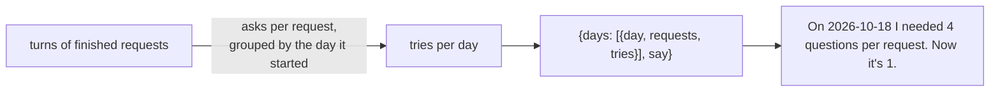

# Branch: feature/speech-trend

A new tool, `speech_trend`: how many questions Alexa needed per finished request, day by day. It is the number that shows Alexa learns the person over time, and it comes straight from memory, with nothing new to store.

Builds on [feature/yes-no-mode](feature-yes-no-mode.md), which made every reply carry `tries`.

## How it works



- A request counts once it is `done`. Cancelled and replaced ones are left out: they say nothing about how well Alexa understood.
- `tries` for a day is the average number of `ask` turns over that day's requests, to one decimal.
- The last `TREND_DAYS` days are returned, oldest first.

## Commits

| Commit                                 | What it did                                                                                   |
| -------------------------------------- | --------------------------------------------------------------------------------------------- |
| `feat: count tries per day in memory`  | `MemoryStore.tries_per_day` and the `DayTries` model; one SQL query over turns and requests.  |
| `feat: add the speech_trend tool`      | The tool, its description, the three sentences in `Reply`, `TREND_DAYS`.                      |
| `docs: add speech trend branch notes`  | This page, the README and the task list.                                                      |

## Tests

```bash
uv run pytest tests/test_speech_trend.py
```

- Requests are averaged per day and listed oldest day first; only finished requests count; only the last days; nobody else's requests.
- Over MCP with the mock brain, the yes/no scenario ("call", "c", "cuh", "k", "yes", "yes") then `do_confirmed_request` gives one request with 4 questions today.
- The sentence compares the first day to the latest.

## Decisions made on this branch

- **Derived, not stored.** The count comes from the turns, so it can never disagree with the conversation.
- **Finished requests only.** A cancelled request with nine questions would be noise, not a trend.
- **Days as ISO dates.** The host or page can word "day one" and "today"; the server stays plain.

## Still open

1. **The page shows it** since [feature/ask-for-help](feature-ask-for-help.md): one line under the conversation.
2. **`speech_practice`** can reuse this query shape for its own scores.
