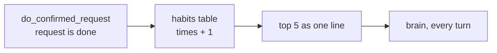

# Branch: feature/usual-requests

Alexa counts what the person asks for most and uses it to understand broken speech faster, like "c… mom" → "Call Mom?".

Builds on [feature/new-request](feature-new-request.md), which keeps each request in its own row. The counts come from those rows.

## What changes



The brain sees one extra line next to the history:

> This person often asks to: call mom (12 times), reminder pills (5), message ahmed (3)

## Steps

- [ ] **1. Table:** add `habits` to `memory/schema.sql`:

  | Column      | What it holds                                                    |
  | ----------- | ---------------------------------------------------------------- |
  | `user_id`   | the person                                                       |
  | `intent`    | reminder, message or call                                        |
  | `subject`   | `who` for a call or message, `what` for a reminder; lowercased  |
  | `times`     | how many times it was done                                       |
  | `last_used` | when it was last done                                            |

  One row per user, intent and subject.
- [ ] **2. Store:** add `add_habit(conversation_id, request)` and `usual_requests(conversation_id, limit)` to `memory/store.py` and `memory/sqlite.py`. Adding the same habit again adds 1 to `times`. Most used first.
- [ ] **3. Count it:** in `tools/do_confirmed_request.py`, call `add_habit` right after the request becomes `done`.
- [ ] **4. Setting:** `MEMORY_USUAL_REQUESTS` (5) in `config/settings.py` and `.env.example`.
- [ ] **5. Give it to the brain:** render the line in `memory/context.py` and add it in `History.for_brain` (`memory/history.py`), so the brain's signature doesn't change.
- [ ] **6. Prompt:** in `understand_speech.txt`: use the usual requests to understand unclear pieces, but still confirm.
- [ ] **7. Tests:** a done request is counted; pending and cancelled are not; "Mom" and "mom" are one; most used come first; the brain's history includes the line.
- [ ] **8. Try it:** finish "call mom" a few times, then say only "c… mom". Alexa should guess "Call Mom?".
- [ ] **9. Docs:** add a "Usual requests" part to `docs/memory.md`.

## Decisions

- **Count only what was done.** A request the person said yes to and that was carried out is sure. Pending or cancelled ones may have been misunderstood.
- **Count when it happens, don't search the history.** One row per habit, updated in `do_confirmed_request`. Reading the top 5 stays fast however long the history gets.
- **No time.** A call or a message has no time, and reminder times come in many shapes. The goal is understanding *what* and *who*, not filling in details.
- **Still confirm.** Usual requests help guess; they never skip the yes.

## Tests

```bash
uv run pytest
uv run ruff check mcp-server tests
```
