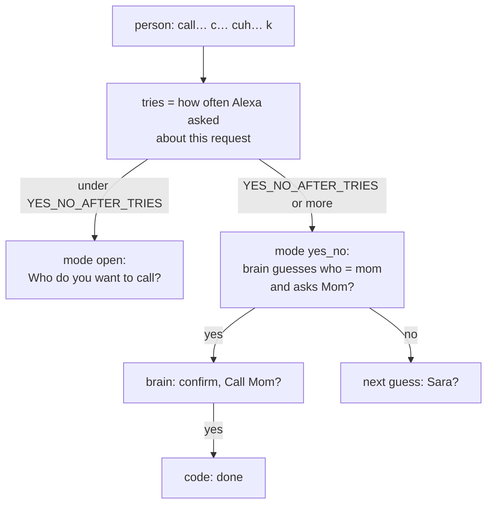

# Branch: feature/yes-no-mode

After a few failed questions about one request, Alexa stops asking the person to repeat themselves and guesses instead: "Mom?". A yes accepts the guess, a no brings the next one. Saying yes or no is far easier than saying a name again for the people this is for.

## How it works



Every reply now carries `tries`, and the brain is told what Alexa last said about the open request (`question`), so "mom" after "Who do you want to call?" and "yes" after "Mom?" read as answers.

## Commits

| Commit                                                   | What it did                                                                                   |
| -------------------------------------------------------- | --------------------------------------------------------------------------------------------- |
| `feat: count how often Alexa asked about a request`      | `tries` on `Moment` (the `ask` turns of the open request) and in every reply.                 |
| `feat: tell the brain what Alexa last said`              | `question` in the brain's input: the last thing Alexa said about the open request.            |
| `feat: ask yes or no after a few failed tries`           | `YES_NO_AFTER_TRIES`, the `AskMode` the brain sees (`open` or `yes_no`), the prompt rule, mock answers. |
| `docs: add yes-no mode branch notes`                     | This page, the README and the task list.                                                      |

## Tests

```bash
uv run pytest tests/test_yes_no_mode.py
```

- `tries` counts only Alexa's questions about the open request, and starts again for the next request.
- The brain is called with the question Alexa last asked, and with mode `yes_no` from the configured try onwards.
- Over MCP with the mock brain: "call", "c", "cuh", "k" gets "Mom?" on the fourth turn with `who: mom` guessed; "yes" confirms it, a second "yes" carries it out.

## Decisions made on this branch

- **The brain guesses, the code still decides.** The guess is only a question; nothing happens until the person says yes to a confirm, exactly as before.
- **No new tool.** The task list called this `yes_no_mode`; it is a mode of `understand_speech`, so a host needs nothing new.
- **`tries` is derived, not stored.** It is counted from the turns, so there is no column to keep in step. `speech_trend` can count the same way, per day.
- **The question goes to the brain for every turn, not only in yes/no mode.** It costs a few tokens and makes "ten" after "What time?" and "yes" after "Mom?" unambiguous.

## Still open

1. **Guesses with a real model.** The mock scenario fixes the guess; with OpenRouter or Groq the prompt rule decides. Worth one listen with a key set.
2. **Usual requests** (Rana's branch) will make the guesses much better: the brain is told to use them when it has them.
