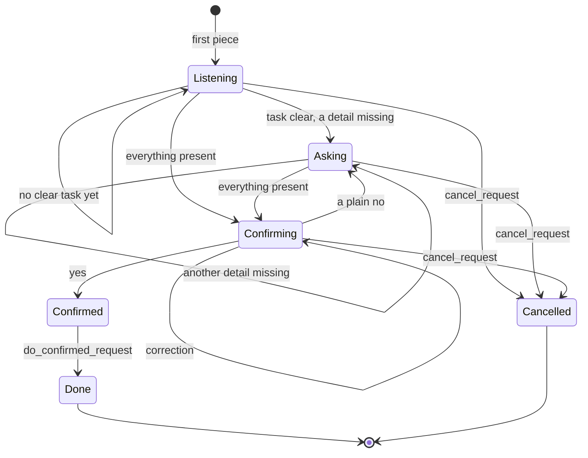

# MCP Server

The MCP server is our Alexa+ add-on and the heart of the project. It offers a few tools that any Alexa+-style agent can call. The brain and the memory sit behind them.

## Why MCP

The Alexa+ track asks for a self-hosted MCP server on spec **2025-11-25 or later**, over **Streamable HTTP**. Judges check this first, and it's pass or fail. So:

- The server runs at `http://<host>:<port>/mcp`.
- It uses Streamable HTTP. stdio doesn't count for this track.
- It really imports and calls MCP. Today that's `FastMCP` from the `fastmcp` package, in `mcp-server/server.py`.

## The tools

| Tool | What it does | Tier |
| --- | --- | --- |
| `understand_speech` | Takes the person's exact words for this turn, adds them to what we've heard, and returns the task, details, what's missing, the next move and a short sentence to say. | Must |
| `do_confirmed_request` | Carries out the pending request, but only if it was confirmed. | Must |
| `cancel_request` | Drops the pending request when the person says to stop. | Must |
| `resume_unfinished` | At the start of a session, returns any request left unfinished last time. | Must |
| `remember_word` | Saves a personal shortcut, like "my pills" meaning blood pressure medicine. | Should |

Tool descriptions matter more than they look. They're the instructions an agent reads before deciding to call a tool, so they have to say clearly when to use each one.

## The contract

The simulator, the tests and any agent all use the same contract. That's what lets us build in parallel, so we change it only on purpose.

`understand_speech`

```json
{
  "input": { "user_id": "demo-user", "heard": "doctor ten" },
  "output": {
    "task": "reminder",
    "details": { "what": "doctor appointment", "when": "2026-09-28T10:00" },
    "missing": [],
    "changed": [],
    "assumptions": ["ten means 10 AM"],
    "next_move": "confirm",
    "say": "Should I set a reminder for your doctor appointment tomorrow at 10 AM?",
    "pending_id": "p_81f2"
  }
}
```

`next_move` is one of `listen`, `ask`, `confirm` or `done`.

`do_confirmed_request`

```json
{
  "input": { "user_id": "demo-user", "pending_id": "p_81f2" },
  "output": { "done": true, "say": "Done. Reminder set for tomorrow at 10 AM." }
}
```

Results are structured, with output schemas, so the agent and the X-ray panel can read them reliably.

## The life of a request



If the app closes in any state before Done or Cancelled, the request stays in memory, and `resume_unfinished` offers it back next time.

## Rules the server enforces

These live in code, not just in the prompt. A prompt can be ignored; code can't.

- **Never act without a yes.** `do_confirmed_request` refuses unless the brain recorded a clear yes for that `pending_id`.
- **One pending request per person.** A new request replaces an unfinished one only after the old one is done or cancelled.
- **A correction keeps the request.** "No, eleven" changes one detail. The `pending_id` stays the same.

## Settings

| Variable | What it controls | Starting value |
| --- | --- | --- |
| `MCP_HOST` | Address the server listens on | `127.0.0.1` |
| `MCP_PORT` | Port the server listens on | `8000` |

## Where we are

- Done: the server runs over Streamable HTTP, and MCP Inspector connects on `2025-11-25`.
- Done: `understand_speech` with a fake brain that returns fixed answers.
- Next: the real brain, then `do_confirmed_request` and `cancel_request`, then memory and `resume_unfinished`.

## Done when

Every must-have tool works from MCP Inspector, results match their schemas, and the protocol version shows `2025-11-25`.
