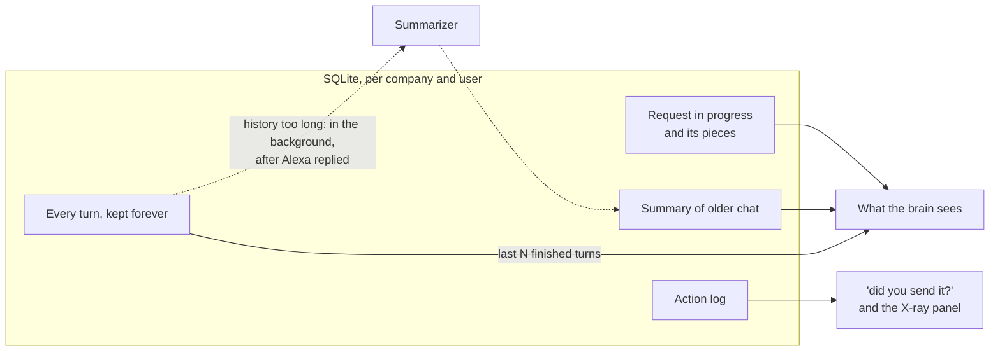

# Memory

How our Alexa remembers what a person said, without getting slower as the conversation grows. This page describes what is built on `feature/memory`.

## The problem

People whose speech is slow or broken rarely say a request in one go. They pause, come back, correct themselves, or close the app halfway. If Alexa forgets any of that, they have to start over, which is exactly what we promise will never happen.

But what we send to the brain can't grow forever either: the more it reads on every turn, the slower and more confused it gets. So memory keeps everything, and shows the brain only what matters now.

## What we remember

### The request in progress

Every piece the person said for the current request, exactly as heard, plus what was understood so far (intent and details). It's saved on every turn, so closing the app loses nothing.

A request ends when it's done or cancelled. The next words start a new one.

If a request is left unfinished, `resume_unfinished` offers it back at the start of the next session, for `MEMORY_UNFINISHED_TTL_HOURS` (24 by default). After that it expires, and new words start fresh.

### Every turn

Each turn stores what the person said **and** what Alexa answered, in order. Alexa's replies matter: "ten" means nothing unless the brain knows Alexa just asked "What time?".

Turns are never deleted.

### The summary

When the history of finished requests gets longer than `MEMORY_SUMMARY_TRIGGER_WORDS`, the older part is summarized. The summary is rebuilt from the previous summary plus the newly covered turns, so nothing important drops out between rounds.

- It runs in a background thread **after** Alexa has already replied, so the person never waits for it.
- It only covers finished requests, never the request in progress.
- If the summarizer fails, nothing is written. It simply tries again after the next turn.
- In mock mode a deterministic summarizer runs, so this works with no key.

### The action log

One row for everything Alexa did: "Reminder set: pills, 8:00." It answers "did you send it?" and feeds the X-ray panel.

## What the brain sees on every turn

1. All pieces of the request in progress.
2. The summary of older conversation, if any.
3. The last `MEMORY_RECENT_MESSAGES` finished turns in full.

A short conversation has no summary, so the brain reads the full history. A long one reads the summary plus the recent turns. Either way the full history stays in the database.

## Companies and users

Every user belongs to a company, and every query goes through that pair. The same user id in two companies never shares anything. For now the company comes from `MEMORY_COMPANY_ID`, never from the caller. When authentication (Descope) is added, it will come from the token instead.

## Tables

| Table           | One row is                                | Key columns                                             |
| --------------- | ----------------------------------------- | ------------------------------------------------------- |
| `companies`     | A company using the server                | `id`                                                    |
| `users`         | A person, unique per company              | `company_id`, `external_id`                             |
| `conversations` | One user's conversation                   | `user_id`, `started_at`                                 |
| `requests`      | A request and its state                   | `id` (the `pending_id`), `intent`, `details`, `status`  |
| `turns`         | One exchange, in order                    | `conversation_id`, `request_id`, `seq`, `heard`, `say`  |
| `summaries`     | The running summary of a conversation     | `conversation_id`, `text`, `covers_up_to_seq`           |
| `actions`       | Something Alexa did                       | `request_id`, `result`                                  |

## The rules the server enforces

- `do_confirmed_request` only runs a request whose status is `confirmed`, and only once.
- A yes is any word from a short list (yes, yeah, yep, mm-hm, …) while Alexa was confirming. A plain no asks what to change. Anything longer, like "no, mom", goes to the brain as a correction.
- The company is never taken from tool input.

## Settings

| Variable                       | What it controls                                   | Default          |
| ------------------------------ | -------------------------------------------------- | ---------------- |
| `MEMORY_DB_PATH`               | Where the SQLite file lives                        | `data/memory.db` |
| `MEMORY_COMPANY_ID`            | The company every caller belongs to, for now       | `demo`           |
| `MEMORY_UNFINISHED_TTL_HOURS`  | How long an unfinished request is offered back     | `24`             |
| `MEMORY_RECENT_MESSAGES`       | How many finished turns the brain always sees      | `10`             |
| `MEMORY_SUMMARY_TRIGGER_WORDS` | How long the history can get before summarizing    | `400`            |

## How it fits in the code

| Piece                         | One job                                                            |
| ----------------------------- | ------------------------------------------------------------------ |
| `memory/store.py`             | The `MemoryStore` interface the rest of the code talks to          |
| `memory/sqlite.py`            | The SQLite implementation, WAL mode, foreign keys on               |
| `memory/history.py`           | Builds what the brain sees, and decides when to summarize          |
| `brain/summarizer.py`         | Turns old turns into a short summary, real or mock                 |
| `tools/*.py`                  | One MCP tool each, using the pieces above                          |

## Ideas we considered and dropped

- **Keep only the last N messages.** It can throw away something said early that still matters.
- **An LRU cache.** Conversations have an order; the oldest part gets summarized, not evicted.
- **Summarizing on every turn.** An extra model call each time would break the 2-second target.
- **Deleting summarized messages.** We keep them: companies may need the full record, and the X-ray panel shows it.
- **AgentCore Memory.** Needs AWS, so judges couldn't run it. It can come later behind the same `MemoryStore` interface.
