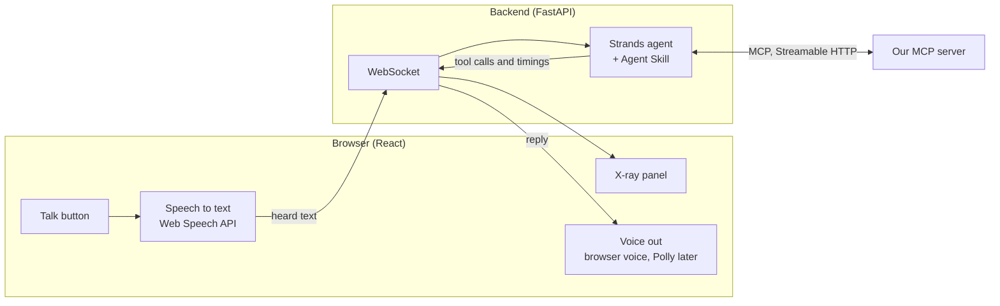

# Simulated Alexa+

Amazon's Alexa+ add-on tools are partner-only, so hackathon teams can't run inside real Alexa+. We build our own simulator instead. It's how judges see and hear the project, and it should feel like talking to Alexa on an Echo Show, with an X-ray panel that shows what's happening inside.

We say clearly, everywhere, that the demo runs in our own simulator.

## How it's built

| Piece | Our pick | Why |
| --- | --- | --- |
| Front end | React with Vite | Quick to build a polished screen with a device view, a big talk button and the X-ray panel. |
| Backend | FastAPI | Runs the agent and streams each turn to the X-ray panel over a WebSocket. |
| Agent | Strands Agents SDK with a Bedrock model | Built-in MCP support in a few lines, and it counts for the AWS Builder mini challenge. |
| Voice in | Push-to-talk + the browser's Web Speech API | Zero setup. Push-to-talk means pauses never cut anyone off. Works best in Chrome. |
| Voice out | The browser's voice first, Amazon Polly as a should-have | Polly sounds much better on video. |

## What the screen shows

| Area | What's in it | Tier |
| --- | --- | --- |
| Device view | A simple Echo Show-style screen with a light bar that moves while listening and speaking. Our own design, no Amazon logos. | Must |
| Talk button | Hold to talk with the mouse, touch or the space bar. Big and easy to hit. | Must |
| X-ray panel | Pieces as heard, tool calls with inputs and results, what's missing, assumptions, what changed after a correction, time per turn. | Must |
| Confirmation card | The understood request in large text, with Yes and Change buttons, so people can tap instead of speak. | Should |

## The honest "before"

A **resilience off switch** runs the same simulator without our tools and skill. It gives a fair before-and-after in the video without making claims about how real Alexa behaves.

## Speed

We measure from releasing the talk button to hearing the reply, and aim for **under about 3.5 seconds**. The biggest win is speaking the tool's `say` sentence directly instead of waiting for another model call to rephrase it.

## Privacy

In Chrome, speech recognition may be processed by the browser maker's servers. Our own app stores text only, never audio. The README says so.

## Settings

| Variable | What it controls | Starting value |
| --- | --- | --- |
| `MCP_SERVER_URL` | Where the agent finds our MCP server | `http://127.0.0.1:8000/mcp` |
| `AGENT_MODEL_ID` | The Bedrock model the agent runs on | Nova 2 Lite |
| `AWS_REGION` | Same region as the brain | where our model is available |

## Open question

The agent itself runs on Bedrock, so judges without AWS can't run it as-is. Mock mode covers the brain, but we still need a fallback for the agent: a simple one that calls `understand_speech` on every turn and speaks the returned sentence. The design already speaks `say` directly, so this should be small.

## Build order

1. Text first: a chat box that sends text to the agent, which calls our MCP server.
2. The X-ray panel, fed by the agent's tool-call events.
3. Push-to-talk with the browser's speech recognition, and the browser's voice for replies.
4. The resilience off switch.
5. A speed pass.
6. Should-haves: Polly, then the confirmation card.

## Done when

Someone new can hold the button, speak the four demo scenarios, and follow each turn on screen without help.
