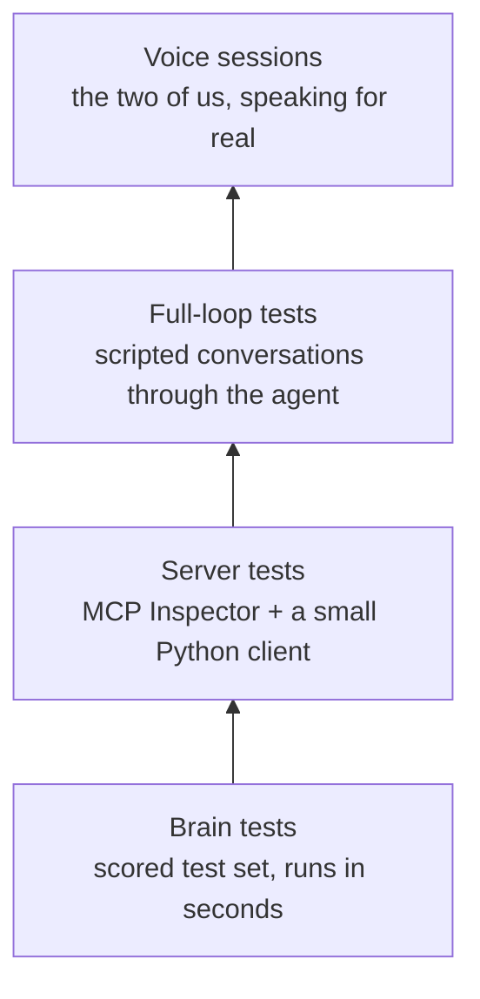

# Testing

We test from the first days, not the last. Most of our progress will come from running the same broken phrases again and again while we tune the prompt.

## The layers

| Layer | What it catches | How |
| --- | --- | --- |
| Brain | Wrong task or details, slow answers | pytest plus a JSON file of test phrases, scored |
| Server | Broken tools, wrong schemas, wrong protocol version | MCP Inspector and a small Python client |
| Full loop | The agent skipping our tools or acting without a yes | Scripted conversations through the simulator's agent, in text mode |
| Voice | Real mishearings that typed tests never show | Sessions together in the simulator |

Every turn also writes one log line: the heard text, tool calls, the guess, the reply and the time. What was actually heard is often the real problem.

## The test set

A JSON file in `eval/`. Each item lists what the person says, turn by turn, and the expected task and details.

| Type | What the person says (turns split by /) | What we expect |
| --- | --- | --- |
| Pieces | tomorrow… doctor… ten | Reminder: doctor appointment, tomorrow 10 AM |
| Mixed order | ten tomorrow dentist remind | Reminder: dentist, tomorrow 10 AM |
| Filler and repeats | um call call… uh mom | Call: Mom |
| Correction | remind pills Tuesday no Wednesday | Reminder: pills, Wednesday. Then ask "What time?" |
| Missing detail | message Ahmed | Message to Ahmed. Then ask "What should it say?" |
| Split across turns | message / Ahmed / running late | Message to Ahmed: "running late" |
| Nickname | call my sister | Call: Sara (from the demo profile) |
| Person corrected | call Sara no mom | Call: Mom |
| Not enough yet | tomorrow | Unknown. Say "Mm-hm, go on." |
| Reference | call mom / message her I'm late | Message to Mom: "I'm late" |
| Calendar (should) | dinner Friday seven calendar | Calendar event: dinner, Friday 7 PM |

We aim for 20 items by October 4 and 30+ by October 11, and every real mistake from a voice session becomes a new item.

## The score

The scoring script prints two numbers: how many items got the right task and details, and the average time per turn.

- Run it after every prompt or code change.
- Don't keep a change that lowers the score.
- Target: **80% or more**, and **under 2 seconds** per turn.

## The four demo scenarios

These are also full-loop tests.

| Scenario | What the person says | What it proves |
| --- | --- | --- |
| The broken reminder | tomorrow… / doctor… ten / yes | Pieces across turns become one request. |
| The change of mind | call Sara… no… mom / yes | Only the corrected part changes. |
| The missing piece | message Ahmed / running late / yes | Alexa asks for one thing, nothing more. |
| The comeback | remind… pills / (close the app, open it again) / eight / yes | An unfinished request survives across sessions. |

## Numbers for the video and write-up

- Task success rate, with the resilience switch on and off.
- Average number of turns to finish a task.
- How many times anyone had to start over. The goal is zero.
- Average time per turn.

## Real people

If we can, we'll get feedback from someone with lived experience of a speech difference, or from a speech-language therapist. We'll explain it's a prototype, ask for consent and respect their time.
